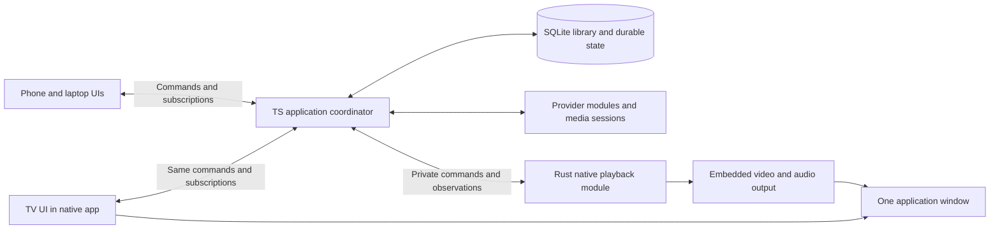

# An integrated media center with shared LAN state

Research updated 2026-09-05. This describes the broader architecture; [README](../../README.md) records the implementation and test commands. Embedded Linux playback, native settings, a persistent queue, local library, M3U radio feeds/favorites, Jellyfin, YouTube/Twitch/RaiPlay catalogs, shared saved items and paired LAN remotes are implemented. Confirmed scope: one Linux mini PC connected to a TV, one playback instance, multiple phone/laptop controllers on the local network, and real-time shared controls and app state. Sources include local/network media, Jellyfin, radio, Bandcamp, YouTube, Twitch, RaiPlay and website media. Speaker-only multiroom is a future feature. Multi-device video playback is not proposed.

The product should have one TV interface, common playback controls, source browsing, a library, shared queue, settings, pairing, installation and updates. Provider iframes, external browser handoffs and switching between separately operated players are not the intended experience. Native libraries or private workers are acceptable implementations behind that product; the application must own their setup, lifecycle and failures.

Read this with the [Kodi parity matrix](feature-parity.md), [playback and transcoding design](playback.md), and [provider integration research](providers.md). These four documents replace the overlapping earlier notes.

The production remote is a real React web app served over HTTP by Bun, with a
WebSocket for shared state and commands. Its controller layout contains catalogs
and controls without a video surface. Tauri uses the same components in a
fullscreen TV layout over embedded native video. Paired directional commands go
only to the trusted TV subscription, without persistence or reconnect replay;
ordinary browsing stays local to each device. The optional Docker preview adds noVNC solely
to view its virtual Linux desktop from a Mac browser. VNC is a development aid;
the TV application and phone remotes do not depend on it.

Watching profiles own local progress and playback defaults for languages,
subtitle mode and speed. The playback device owns volume and audio delay.
Controller identity authorizes shared controls and does not select a viewer.
Text-subtitle uploads contain file bytes from the controller, never a requested
host path. Bun also fetches Jellyfin sidecars with bounded, cancellable requests;
libmpv receives private local files and owns subtitle rendering and selection.

Saved playlists belong to the shared household catalog. Bun captures original
queue references into SQLite, checks revisions for edits and loads, and broadcasts
the playlist version after commit. Public playlist views omit sources. Loading
creates fresh queue occurrence IDs; append preserves playback, replace stops it,
and Play replaces the queue and starts its first item. Album Play appends its
ordered tracks and starts the first. Each controller retains its own music
browsing view.

The library uses pinned `music-metadata` for audio tags and embedded artwork,
with ffprobe retained for video. SQLite holds artist membership, album identity,
disc/track numbers and bounded content-addressed artwork blobs. Artwork routes
require controller authorization; clients fetch blobs and release their object
URLs when no longer used. Existing audio rows receive the new metadata on rescan.

## Recommendation and real alternatives

Use Tauri 2 as the desktop direction, TypeScript for product logic and UI, Bun for the application coordinator, SQLite for persistence, and libmpv for native playback. Start shared controls with Bun's native WebSocket pub/sub and small complete session snapshots. This is the simplest credible design after comparing it with game state engines, Redis and OSC. Linux rendering and protected-source qualification remain early gates; choosing Tauri does not establish those capabilities.

The native module is justified by the requested integrated player, not a speculative server performance problem. It owns the window/rendering bridge, decoder/output lifecycle and observations. The TypeScript coordinator owns queues, library changes, source sessions, household controls and persistence. A native observation of what actually played is input to the coordinator; it is not a second competing queue authority.

| Part | Starting choice | Reuse boundary |
| --- | --- | --- |
| TV and remote UI | React + TypeScript, Bun HTML bundling/HMR and build API | Shared components and commands; Tauri bundles static assets and owns the Bun sidecar |
| Directional TV focus | Radix interaction and a DOM geometry arrow-key handler | Dialog/select/tab/slider behavior stays with Radix; the app handles directional movement between visible controls and local back/focus restoration |
| App coordinator | Bun HTTP/WebSocket server and TypeScript modules | Serve browser assets, catalogs and one shared session |
| Persistence/search | `bun:sqlite` and SQLite FTS5 | One embedded database; ordinary migrations and queries before adding an ORM |
| Native host/player | Tauri 2, Rust and libmpv | Try the existing native video plugin; own only the adapter and missing integration |
| Source compatibility | Direct TS adapters and selected managed workers | Add dependencies with supported features, keeping one UI and queue |

The frontend choice is a reuse recommendation, not a performance ranking: Bun supplies HTML bundling and hot reload, and Radix supplies focus management for dialogs, selects and tabs. A small layout-based handler moves focus between the remaining controls; Norigin remains a candidate if nested TV focus behavior outgrows it. The native decoder does the heavy media work. The implementation uses Bun's build API directly instead of adding Vite. [Bun fullstack](https://bun.com/docs/bundler/fullstack), [Norigin](https://github.com/NoriginMedia/Norigin-Spatial-Navigation), [Bun SQLite](https://bun.com/docs/runtime/sqlite), [SQLite FTS5](https://sqlite.org/fts5.html)

| Alternative | Main advantage | Main cost | When it wins |
| --- | --- | --- | --- |
| Kodi distribution with redesigned skin and TS remote | Broadest working playback, add-on, PVR and library coverage immediately | TV skins remain Kodi XML; C++/Python core and existing interaction rules remain | Existing parity matters more than new implementation architecture |
| Fork Kodi and replace more of its UI | Retains more of its native/add-on integration while permitting deeper changes | Major GUI/core integration, upstream maintenance and retained legacy contracts | Kodi add-on compatibility and a changed product are both mandatory |
| New TS/Bun app with Rust/libmpv integrated player | Own modern UI, shared state, provider model and standalone library; retains TS development workflow | Build media-center behavior outside the decoder; qualify rendering and protected sources | Preferred new-product path if we accept the explicit parity work |
| Rust coordinator and media host with TS UI | One native application runtime for state and playback; natural native-library integration | More application code leaves TS; TS provider code may still require a managed runtime | One-runtime deployment or a native-heavy product outweighs TS server preference |
| Rust/native UI with libmpv or GStreamer | More direct control of the Linux graphics/output stack | Separate TV and web-remote UI implementations; more native UI work | The required display/output profile fails the web/native composition route |
| Go coordinator with TS UI | Practical native daemon development | Another bridge to GUI/media libraries; no demonstrated advantage for this workload | A concrete daemon/deployment requirement favors Go |

Kodi JSON-RPC is an interface to a running Kodi application, not a standalone rendering library. Kodi's VideoPlayer directly uses application, GUI, settings and windowing facilities. A custom skin preserves parity much more easily than extracting a new engine from those dependencies. [Kodi skin development](https://kodi.wiki/view/Skin_development_introduction), [Kodi VideoPlayer](https://github.com/xbmc/xbmc/blob/master/xbmc/cores/VideoPlayer/VideoPlayer.cpp), [JSON-RPC](https://kodi.wiki/view/JSON-RPC_API)

Three existing implementations deserve study. Jellyfin Desktop demonstrates native libmpv video and web UI in one window. Grayjay Desktop demonstrates one product UI and plugin model across online sources, though its media-center scope and custom license differ. Kira demonstrates a TypeScript YouTube integration with an app-owned player. These are architecture references, not claims that any one already supplies this complete product. [Jellyfin Desktop](https://github.com/jellyfin/jellyfin-desktop), [Grayjay Desktop](https://github.com/futo-org/Grayjay.Desktop), [Kira](https://github.com/LuanRT/kira)

## Product layout and ownership

Start with the coordinator and native module on the same mini PC. A headless coordinator and remote native receiver can be separated later if an actual deployment needs it. Do not turn this into several independently deployed services now. Bun and the Rust host can be private cooperating processes launched by one application entry point, with one config/data location and coordinated updates. The installer ships required native dependencies instead of asking users to assemble them.

Reuse Tauri's sidecar support to package and start a compiled Bun executable, plus its official single-instance and logging plugins. Add autostart, dialog and updater plugins with the corresponding features. The app still owns startup readiness, shutdown and recovery policy. Bun already owns data, file scanning and provider HTTP; adding parallel Tauri SQL/store/HTTP layers would duplicate responsibility. Tauri channels can serve local UI/native messages, but do not replace the LAN connection. [Sidecars](https://v2.tauri.app/develop/sidecar/), [Bun executables](https://bun.com/docs/bundler/executables), [single instance](https://v2.tauri.app/plugin/single-instance/), [logging](https://v2.tauri.app/plugin/logging/), [channels](https://v2.tauri.app/develop/calling-frontend/#channels)

Use four modules with small interfaces:

- Library: ingest local/network files or remote catalogs, query items, apply metadata/user changes, and publish invalidations. Its implementation owns scanning, caching, persistence and upstream reconciliation.
- Sources: browse/search/authenticate and open or refresh a playback session. Its implementation owns expiring credentials, protocol details and provider failures.
- Session: serialize commands, own the queue and active profile, persist durable changes, reconcile native observations, and publish authoritative state.
- Playback: load a supported media session, apply supported transport/output commands, and emit observations. Its implementation owns native rendering, decoding, tracks, buffering and cleanup.

These are modules in one product. Their interfaces should hide implementation complexity without claiming every source has the same controls. A local MKV, a radio stream and a protected live provider have different capabilities. Share TypeScript command/state definitions and runtime validation between TV and remotes. Keep native messages few and explicit; introduce generated Rust bindings when the actual contract warrants them. Do not build a public plugin marketplace or a general event framework before real integrations establish the necessary interface.

The application has its own standalone local/NAS library. Jellyfin is an optional source of library data, playback negotiation and progress, not a required installation for local files. Integrating a Tvheadend-like PVR backend is compatible with a single product experience when our UI owns channel setup, guide, scheduling, recordings and errors. See [feature parity](feature-parity.md) for the exact obligations.

## Shared state is server-authoritative pub/sub

Every TV button, phone control and physical remote input goes through the same session commands. Only one playback instance exists. Remotes subscribe to its state; they do not independently resolve the source, decode media or send watch progress upstream.

| State | Owner and handling |
| --- | --- |
| Queue, current item, repeat/shuffle, active watching profile | Coordinator; durable where appropriate |
| Observed playing/paused/buffering/error, track selection, volume, capabilities | Native player observations reduced into coordinator state |
| Favorites, metadata corrections, playlists, watched/resume, settings | SQLite; publish item/query invalidations after committed changes |
| Playback position and buffer telemetry | Native observations in memory, periodic/on-change checkpoints |
| Browsing route, search text, open menu and focus on each remote | That UI locally; one person's browsing should not navigate everyone else's device |
| TV navigation controlled from a phone's directional pad | An explicit TV input command; distinct from browsing the phone's own catalog |
| Credentials, license requests and resolved media addresses | Host/provider session; never needed by a remote just to pause the TV |

A short example defines the behavior. Phone A sends `pause` with a command ID and the active playback generation. The coordinator accepts it, orders it against other commands and marks it pending. The native module applies it and reports paused. The coordinator publishes the resulting state to A, B and the TV. A transport acknowledgement is not proof that the player paused. A player error is a published result, not a silent divergence.

Queue entries have their own IDs even if the same song appears twice. Prefer `remove(entryId)`, `move(entryId, beforeEntryId)` and explicit transport values over clients replacing a stale entire queue. Reject or rebase stale destructive edits according to a documented command rule. Include the active media/session generation with seek/track commands so a delayed command cannot affect a newly loaded item.

For ordinary scalar settings, the last command accepted by the coordinator wins. If A requests volume 40 and then B requests 60, every client eventually sees the player's confirmed 60. Concurrent queue insertions retain both distinct entry IDs in server-accepted order. An invalid move is rejected with fresh state available; there is no peer-to-peer conflict merge or distributed consensus.

Serialize state transitions in a single coordinator. Long source resolution and scanning jobs run asynchronously; completion carries the generation/job identity so cancelled or obsolete work cannot overwrite a newer selection. Do not block pause or volume behind a slow catalog request.

The pub/sub transport carries changes; the database stores durable state. They have different jobs. A message broker alone does not resolve competing commands or recover an authoritative snapshot.

## Control and state alternatives

For v1, choose **Bun WebSockets with full small session snapshots**. Bun already supplies topic broadcasting, protocol pings, connection limits and backpressure controls. The browser uses its standard WebSocket. We own a small reconnect/request wrapper and the application's command rules. Publish from the server so the sender also receives the authoritative result. There is no need to write a delta engine, replay log or separate telemetry protocol. [Bun WebSockets](https://bun.com/docs/runtime/http/websockets)

| Option | Useful reuse | Remaining cost | Decision for this product |
| --- | --- | --- | --- |
| Plain Bun WebSocket | Native transport and in-process pub/sub | Request results/timeouts, reconnect and replacing current state | Start here; our shared session is small |
| Socket.IO + Bun engine | Reconnect, acknowledgements, broadcasting and connection management | Still define state snapshots and media rules; own protocol/SDK | Reasonable if connection code grows while snapshots remain sufficient |
| Colyseus | Server-owned typed state, initial snapshots, binary deltas, field/collection callbacks, requests and reconnect | Schema/SDK coupling, room lifecycle and Bun qualification | Best higher-level alternative; adopt when it removes substantial replica code |
| Redis Pub/Sub | Fan-out between independent processes | Separate service, browser gateway and current-state recovery; lost offline messages | No current need with one coordinator |
| Redis Streams | Retained events, consumer acknowledgement and replay | Same gateway plus retention/persistence and consumer policy | Useful for a demonstrated durable job/event requirement, not this player state |
| OSC over WebSocket | Standard addresses, typed arguments, bundles and reusable codecs | Application snapshot, queue, request/result, reconnect and pairing rules | Valid primary protocol; strongest benefit is existing OSC controller compatibility |
| OSCQuery | Discoverable parameter tree, values/metadata and optional WebSocket subscriptions | Media semantics, coherent aggregate state and library persistence; implementation qualification | Consider as primary if external control discovery becomes central |
| SpacetimeDB | Transactional reducers, durable tables and reactive query subscriptions | Another database runtime and constrained execution model; native playback remains an external side effect | Revisit only if it replaces significant database/API work |
| TinyBase/Yjs/Automerge | Replicated data and concurrent/offline merge | Authority and playback-side-effect rules still ours | Offline concurrent editing is not a v1 need |
| Nakama or geckos.io | Game backend services or WebRTC game-message transport | Additional runtime/database or signaling; neither removes our media state model | No advantage established for this scope |
| HTTP commands + SSE | Ordinary request handling plus a maintained browser event stream | Two connection paths and the same snapshot/domain rules | Also viable; bidirectional WebSocket keeps the control path together |

These are different layers and can coexist, but combining them now would not make the app simpler. Socket.IO has an official Bun engine; acknowledgements/recovery do not imply durable exactly-once execution. [Bun integration](https://socket.io/docs/v4/server-installation/#usage-with-bun), [delivery](https://socket.io/docs/v4/delivery-guarantees/)

Redis Pub/Sub is explicitly at-most-once and loses messages while a subscriber is disconnected. Streams retain events and can support acknowledgements/replay; crash durability depends on configured persistence. Neither supplies our browser session model. A WebSocket gateway and an authoritative latest state would still exist. Redis is worthwhile when independent producers or hosts actually need a broker. [Pub/Sub](https://redis.io/docs/latest/develop/pubsub/), [Streams](https://redis.io/docs/latest/develop/data-types/streams/), [persistence](https://redis.io/docs/latest/operate/oss_and_stack/management/persistence/)

OSC is transport independent, not UDP-only. OSCQuery's proposal adds HTTP parameter discovery and an optional WebSocket extension for binary OSC, subscriptions and tree changes. Clients must check extensions and re-subscribe after reconnect. A bundle is not a database transaction, and OSC timetags do not synchronize speaker clocks. [OSC specification](https://opensoundcontrol.stanford.edu/spec-1_0.html), [OSCQuery proposal](https://github.com/Vidvox/OSCQueryProposal)

For an eventual OSC adapter, reuse `osc-js` or Rust `rosc`, mapping addresses such as `/player/pause` and `/player/volume` into the existing session commands and publishing observed results. Do not expose a second path that controls mpv behind the coordinator. For a complete OSCQuery implementation, libossia supplies server/mirror parameter propagation and a C ABI, at the cost of a C++ dependency. The inspected TS `node-oscquery` explicitly lacks bidirectional WebSocket support, and Rust `oscquery` 0.2.0's server implements HTTP queries without subscriptions. Those packages are not complete drop-in state engines. TouchOSC supports UDP/TCP; its discovery documentation is not proof of OSCQuery compatibility. [osc-js](https://github.com/adzialocha/osc-js), [rosc](https://docs.rs/rosc/latest/rosc/), [libossia](https://ossia.io/ossia-docs/), [node-oscquery](https://github.com/jangxx/node-oscquery#supported-extensions), [Rust server](https://docs.rs/crate/oscquery/0.2.0/source/src/server.rs), [TouchOSC](https://hexler.net/touchosc/manual/connections-osc)

SpacetimeDB is the more substantial architecture alternative: reducers and subscribed tables can replace both an API and persistence work. It is not simply a WebSocket helper to add beside our SQLite coordinator. Native playback cannot be included in its database transaction. TinyBase's mergeable stores and CRDT libraries address another problem: independent writers that must merge. Neither is required just because several remotes can command one authority. [SpacetimeDB reducers](https://spacetimedb.com/docs/functions/reducers/), [TypeScript SDK](https://spacetimedb.com/docs/clients/typescript/), [TinyBase synchronization](https://tinybase.org/guides/synchronization/)

Nakama uses a constrained JS runtime rather than the Bun ecosystem, and its authoritative match state does not automatically broadcast itself. geckos.io focuses on WebRTC messaging rather than application-state replication. Their gaming focus alone is not a reason to adopt them. [Nakama runtime](https://heroiclabs.com/docs/nakama/server-framework/typescript-runtime/#compatibility), [match state](https://heroiclabs.com/docs/nakama/concepts/multiplayer/authoritative/#match-state), [geckos.io](https://github.com/geckosio/geckos.io)

## The smallest complete state flow

Use three message kinds: `command`, `result` and `state`. A command carries a request ID, explicit action and any relevant item/entry identity. A result reports acceptance or rejection. The state reports what the player actually did. The live snapshot contains compact queue entries, active item, profile, transport, tracks, volume, capabilities, position and small library/settings invalidation versions. Artwork and catalog pages remain ordinary fetched data.

1. After pairing, connect and receive current state before enabling controls. Subscribe and enqueue the initial snapshot synchronously in the coordinator's state loop.
2. Apply commands through the same session module for TV, phones and external inputs. Explicit `setPaused(true)` and `setVolume(60)` avoid ambiguous concurrent toggles. A transport acknowledgement does not mean playback applied.
3. Reduce native player observations into one current state. Broadcast full small snapshots on changes and initially around twice per second during playback. Update the progress bar locally between observations; measure snapshot size before introducing deltas.
4. On disconnection, disable controls, clear unsent actions and pending requests, and reconnect with bounded backoff. A new connection replaces its state from a fresh snapshot and refetches visible library queries. Do not automatically replay uncertain `next`, seek or enqueue actions.
5. Keep transport and output state alive when the last remote closes. Persist the queue, settings, library and resume checkpoints in SQLite independently of socket membership.

A single ordered snapshot stream removes patch-base checks and a separate telemetry sequence protocol. Discard callbacks from a replaced socket. Anchor progress interpolation at local receipt time; do not subtract the phone's clock from the host's clock. Freeze interpolation on pause, buffering or stale connection. Configure protocol ping/idle handling and bounded outbound queues; close an overloaded connection and let it obtain a fresh snapshot rather than accumulating obsolete state.

Some rules are application behavior whatever library we choose. Queue entries need stable IDs, including repeated songs. Use `remove(entryId)` and `move(entryId, beforeEntryId)`; reject missing anchors instead of replacing another controller's queue with a stale copy. Item-scoped actions carry the current playback token so a delayed seek cannot affect the next movie. Source-resolution completions carry the same token and cannot replace a later selection. Use a native-retained unique token that survives coordinator recovery, rather than a counter reset to zero.

Plain WebSocket does not reconnect or replay application messages by itself. Keep our wrapper free of an offline command queue. An outstanding result lost with a connection is uncertain; refresh state and permit a deliberate new action. Stable enqueue entry IDs with a SQLite uniqueness rule can make a future explicit queue retry safe. Do not implement a generic durable command-receipt store before retry requirements justify one. No protocol can make a SQLite commit and native decoder side effect one transaction.

Optimistic UI may display pending volume or queue edits, then reconcile with the authoritative snapshot. Scrubbing previews locally and sends a bounded number of actual seeks. Local progress now checkpoints native observations every ten seconds and on observed pause/seek, with final flushes on stop, source replacement, errors and shutdown. It belongs to the active named watching profile; profile changes require stopped playback. EOF clears resume and marks watched, as does stopping past 90% for media at least one minute long. Watched and position are independent, so rewinds persist the lower position without clearing the watched mark. A private `load.startPosition` starts libmpv at the saved point and resets for ordinary loads. For Jellyfin-owned items, the host reads and reports the connected account's upstream progress; remotes do not submit their own reports. Restart never autoplays.

## What the game engine experiment established

Colyseus genuinely reuses more state machinery than Socket.IO. The server mutates a tracked schema and clients receive current state plus coalesced deltas and callbacks. It does not decide how competing queue edits, asynchronous source loads or native confirmations should behave. Its state stream is a current view, not a durable history. [State synchronization](https://docs.colyseus.io/state), [schema](https://docs.colyseus.io/state/schema), [callbacks](https://docs.colyseus.io/state/callbacks)

If we choose it, use one host-created room with `autoDispose = false` and local presence/driver. Keep lobby, match selection, client-created rooms and simulation loops out of the product; room bootstrap/join still use the framework's internal matchmaker. Keep SQLite persistence separate. Use `room.request()` for controls and disable ordinary disconnected message buffering. Requests fail offline and have reply/error handling, but lost replies remain uncertain outcomes. Enable controls only after state arrives following reconnection, not merely the reconnect handshake. The native Rust bridge remains private IPC; Rust need not implement Colyseus. [Rooms](https://docs.colyseus.io/room), [SDK](https://docs.colyseus.io/sdk), [reconnection](https://docs.colyseus.io/room/reconnection), [driver scope](https://docs.colyseus.io/server/driver)

Functional experiments ran on Darwin arm64 with Bun **1.4.0**, over real loopback WebSockets with simulated playback state:

| Experiment | Result | What it covered |
| --- | --- | --- |
| Bun native WebSocket, no added package | Passed | Two initial snapshots, updates to sender and peer, queue change, manually established reconnect receiving current state, stale-item rejection, state retained with zero remotes |
| Colyseus native Bun transport | Passed | Two replicas and collection callbacks, request errors, automatic reconnect recovering offline changes, offline requests rejected, room retained with zero remotes |
| Colyseus standard `ws` transport under Bun | Passed | The same Colyseus scenarios using its other transport |

Installed Colyseus versions were core **0.18.10**, schema **5.0.27**, SDK **0.18.2**, Bun transport **0.18.2** and ws transport **0.18.2**. Disposable scripts are `/tmp/modern-kodi-ws.85GSGN/smoke.ts` and `/tmp/modern-kodi-colyseus.vCWMFE/smoke.ts`; they are local evidence, not durable project tooling. Commands were `bun smoke.ts`, and additionally `MEDIA_TEST_TRANSPORT=ws bun smoke.ts` in the Colyseus directory. All final runs exited 0.

The Colyseus disconnect test used a going-away socket close; its documented `leave(false)` simulation did not enter automatic recovery in this Bun run. Native Bun support remains officially experimental, and our successful standard-ws run does not establish universal Node compatibility. The plain-WS experiment did not implement automatic reconnect, so these are not equal feature or performance benchmarks. Neither experiment tested Linux, Tauri, a decoder, Wi-Fi sleep/wake, authentication, persistence, backpressure or crash recovery. [Bun transport status](https://docs.colyseus.io/server/transport/bun-websockets), [standard transport](https://docs.colyseus.io/server/transport/ws)

The threshold for Colyseus is concrete: reconsider it before implementing our own nested state patches, per-field subscription machinery or complex reconnect recovery. More library items alone do not cross that threshold because catalog queries stay paginated outside live session state. Do not ship both replication systems.

## LAN operation and failure ownership

The TV shows its local address and an address-only QR code. Ordinary pairing
uses six digits and creates a named controller with a stable ID. Migration keeps
legacy token hashes unchanged, assigns names and IDs, and leaves every existing
remote an ordinary controller. Controller credentials, watching profiles and TV
presentation remain separate concepts.

An unclaimed TV also shows a distinct ten-digit administrator code, valid for ten
minutes and one claim from a paired phone. Bun checks the current credential at
the mutation boundary, after reading the bounded request body. SQLite consumes
the claim and grants the role in one immediate transaction; competing first
claims produce one administrator. The committed role/name changes invalidate
controller state and broadcast the saved installation name. The administrator
phone edits the name; the native Settings UI and ordinary remotes show it read-only.

Folder and Jellyfin setup remain host-only. Paired directional commands cannot
activate local-only controls or move focus within a protected dialog, including
a separately portalled child. The guard runs when the TV applies the queued
navigation command. Back and Home can dismiss these dialogs. Native presentation
therefore does not grant a remote caller the host's authority.

Trusted-local recovery uses `COUCH_ADMIN_RECOVERY_CODE`; the
[usage guide](../usage.md#recover-administrator-access) documents the operator steps.
Only its hash persists. Restart preserves the original expiry and consumed state,
and Bun removes the variable before media helpers can inherit it. Recovery adds
an administrator without revoking the old credential. Full listing, renaming and
immediate revocation remain in [controller management](https://github.com/avoid-quest/couch/issues/11).

Requests still check the allowed origin and host. Local media and cached library
browsing work without internet; online providers need their upstream connections.
Connection offers Reconnect with the existing credential and Pair again, which
forgets only this browser's credential. Controls wait for a fresh snapshot after
reconnecting.

Basic remote controls can work over local HTTP. Trusted HTTPS is required before depending on secure-context browser features such as an installed share target. The localhost exception belongs to the browser's own device, not another LAN IP. Removing Twitch embeds also removes that embed-specific hostname constraint from normal playback. [Secure contexts](https://www.w3.org/TR/secure-contexts/#is-origin-trustworthy), [Web Share Target](https://developer.chrome.com/docs/capabilities/web-apis/web-share-target)

The application supervises provider/conversion workers, applies timeouts, propagates cancellation and restores a usable screen after failure. Closing a remote has no playback effect. A dropped coordinator connection should not automatically interrupt current native playback, but remotes must show their disconnected state. On reconnect, the coordinator asks the native module for the active generation and observation before restoring state. A full application restart restores the library/queue and offers resume rather than blindly executing old transport commands.

If the coordinator restarts while native playback survives, recover the native module's retained media identity and generation token before accepting transport commands. Do not reuse a reset counter that could make an unrelated new item appear to match stale commands.

## Decisive implementation experiments

1. Integrated renderer: native video with our overlay controls and TV focus, actual hardware decoding, subtitles/tracks, HDMI audio, SDR/HDR behavior and failure recovery. Compare against the established Jellyfin Desktop composition pattern. See [playback](playback.md).
2. Protected and proprietary sources: one real YouTube transport, Twitch, Bandcamp, and representative protected/unprotected RaiPlay titles. This decides whether Tauri/libmpv is sufficient or an integrated CDM-capable backend is required. See [providers](providers.md).
3. Shared state: two phones and the TV perform conflicting queue edits, pause/seek, profile/settings changes and reconnect while the real player emits events. Force coordinator and worker restarts, duplicate a command and simulate a slow subscriber. No stale generation may change the new item.
4. Standalone product: local/NAS library, metadata, favorites, playlists, history/resume, radio, Jellyfin and offline startup. Then complete the chosen PVR, music, output and add-on gates from [feature parity](feature-parity.md).

Proposed responsiveness targets for the LAN experiment are under 100 ms p95 acknowledgement and under 250 ms p95 confirmed state for commands that require no media loading. Measure accepted and applied separately. These are goals, not current performance claims. Decoder startup and provider authorization need their own measurements.

One software product does not require one programming language or one OS process. It requires ownership of the user experience and state. The unresolved choices are the exact Linux renderer/CDM path and its tested hardware profile, not whether we can replace the shared session with a collection of independent players.
