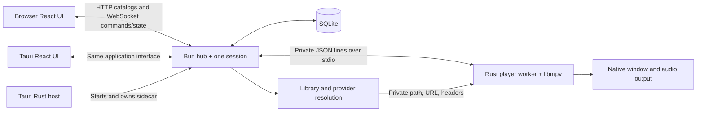
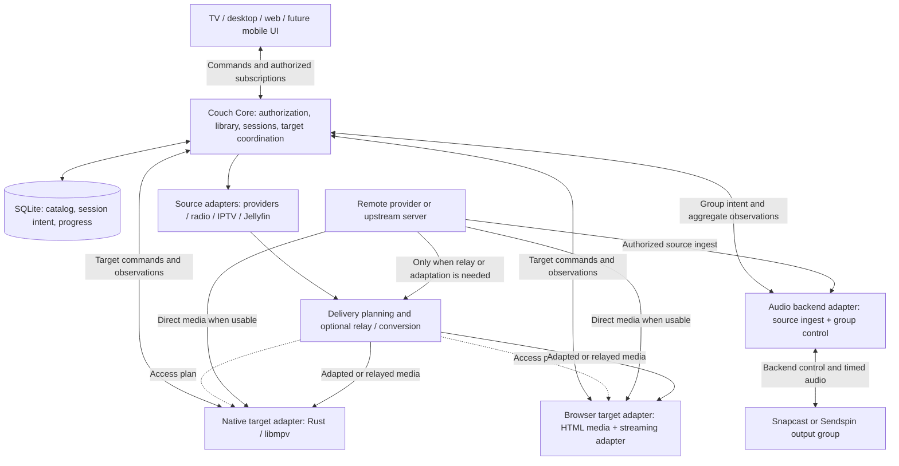

# Device-independent Couch playback

Research and architectural proposal, 2026-09-27. Code inspected at
`81ca2a293907da55e68c4b53a186f9466627392e`. This is a proposed expansion of product
scope, not a claim that browser playback, handoff, or internet serving exists.
The [current architecture](../architecture.md) remains the implementation map.
The September 5 [research](architecture.md) deliberately excluded multi-device
video; that earlier scope should not constrain this proposal. The working product
premise is that **most Couch sources are remote**. Local/NAS files are another
source adapter, not the organizing use case. Future Snapcast and Sendspin
integration is an explicit architectural requirement.

**Recommendation: evolve the existing Bun coordinator into a core that owns
multiple logical playback sessions, assigned to individual endpoints or managed
output groups. Keep React, SQLite, Tauri and libmpv. Generalize existing remote
source resolution into target-aware access and delivery, add browser rendering,
and keep synchronized audio behind a backend adapter. Make handoff explicit.**

The architecture is a strong starting point, but is not already sufficient.
Playback intent is already outside the UI; the limiting assumptions are one
session, one native transport, source resolution shaped for libmpv, and
desktop-owned server lifetime. Remote ingestion is already present. The problem
is making that ingestion usable by other endpoints and synchronized groups.

## 1. What exists today

The desktop process and browser frontend are not two separately implemented
products. `src/client` is the shared React application; Vite produces one build
for Tauri and the Bun-hosted browser UI. `apps/web` is the Astro marketing and
download website, not the Couch browser application. [Build map](../architecture.md),
[build script](../../scripts/build.ts), [README](../../README.md).

The following are findings from source, rather than assumptions from earlier
design documents:

| Existing module / process | Concrete implementation and ownership | Consequence |
| --- | --- | --- |
| Native host | [`src-tauri/src/lib.rs`](../../src-tauri/src/lib.rs), `start_coordinator`, launches the Bun sidecar, creates the player worker, supplies its private token, and handles shutdown | Closing a controller is independent of TV playback, but quitting the owning native application ends its core too |
| Coordinator | [`src/main.ts`](../../src/main.ts) wires `createHub`; private `playback` messages leave over stdout and `player` observations arrive on stdin | Useful existing control/observation seam; it currently identifies only one owning native peer |
| HTTP/WebSocket hub | [`hub.ts`](../../src/server/hub.ts), `createHub`, creates exactly one `createSession`; `/api/ws` accepts commands and broadcasts `state` / `clock`; HTTP modules provide library, sources, playlists, settings and progress | Much browser workflow parity already exists; all commands and subscriptions address the same session |
| Session policy | [`session.ts`](../../src/server/session.ts), `createSession`, owns queue, current entry, play intent, source resolution cancellation, continuation, resume and progress; injects `sendPlayer` | The UI does **not** own the playback queue or open libmpv directly; session policy is nevertheless native- and singleton-shaped |
| Native renderer | [`player.rs`](../../src-tauri/src/player.rs), ordered worker and observations approximately every 250 ms; [`protocol.rs`](../../src-tauri/src/protocol.rs) and the [video plugin](../../src-tauri/vendor/tauri-plugin-video/src/desktop.rs) implement transport/rendering | Retain the proven native implementation; adapt its interface and identity rather than replace the engine |
| Shared contract | [`protocol.ts`](../../src/shared/protocol.ts), `SessionState`, `PlayerState`, `Action`, `PlaybackCommand` | `playbackId` rejects commands for an old load; there is no logical `sessionId`, `targetId`, assignment generation or per-session revision |
| Browser connection | [`session/session.ts`](../../src/client/session/session.ts) obtains a full snapshot, receives clocks, correlates command results and reconnects; [`session-context.tsx`](../../src/client/session/session-context.tsx) selects local/remote credentials | Reuse the connection and query invalidation behavior, but scope it to selected server/session/target |
| Video surface | [`VideoStage.tsx`](../../src/client/sections/shell/VideoStage.tsx) invokes `set_video_rect`; [`PlayerPage.tsx`](../../src/client/sections/now/PlayerPage.tsx) treats nonlocal playback as elsewhere | There is no browser `<video>` / `<audio>` renderer in this playback path |
| Device selection | [`operating_mode.rs`](../../src-tauri/src/operating_mode.rs), `select_playback_device` / `stop_local`; [desktop controller guide](../desktop-controllers.md) | “Another Couch” selects another **core**, stops local playback and retains a maintenance coordinator. It is not a receiver registration, shared-library playback selection, or handoff |
| Persistence | [`store.ts`](../../src/server/store.ts) has single-row `session`, `queue_position`, `playback_continuation`, `watching_state`, `playback_device` and audio output settings | Several persistence assumptions must become session- or target-scoped; library data need not be rebuilt |
| Local media | [`library.ts`](../../src/server/library.ts), `getPlayable`, verifies configured roots and returns private `file:` URLs, with CUE segment offsets where applicable | The server can resolve media securely for a colocated player; it does not serve that media to a browser. Existing probing reads duration/tags, not a complete delivery capability inventory |
| Provider media | [`web-media.ts`](../../src/server/web-media.ts) resolves online URLs, headers and possibly separate audio; [`jellyfin.ts`](../../src/server/jellyfin.ts) negotiates a native profile, explicitly disables direct-stream/transcoding and tracks one active/prepared upstream playback | `web-media` does not mean web-player delivery. Provider credentials/reporting and target-dependent negotiation need a new seam |
| Subtitles | [`subtitles.ts`](../../src/server/subtitles.ts) accepts bounded text uploads, fetches supported Jellyfin sidecars into private temporary files, and deletes by current `playbackId` | Good ingestion protections; file ownership must survive a transfer and support simultaneous sessions |
| Progress | [`progress.ts`](../../src/server/progress.ts) accepts renderer observations, checkpoints about every 10 seconds and on acknowledged seek/pause/end; `replaceTransport` retains progress through a transport replacement | Strong foundation for handoff, but one active writer is assumed. Catalog `sharedProgress` / `sharedHistory` currently aggregate across profiles |
| Native integration | [`native-media.ts`](../../src/client/session/native-media.ts) bridges OS media controls through UI commands; sound/display/Bluetooth modules operate on the host | Separate target hardware from core administration; receiver operation should not depend on a mounted UI hook |
| Authentication/network | [`hub.ts`](../../src/server/hub.ts), [`controllers.ts`](../../src/server/controllers.ts), [`validation.ts`](../../src/server/validation.ts), [`lan-listener.ts`](../../src/server/lan-listener.ts) | Pairing, hashed device tokens, host/origin checks, role checks, command bounds, revocation and a restricted LAN listener exist; user accounts and target ACLs do not |

Two documentation discrepancies matter for planning. `store.pair()` and
[`controllers-store.test.ts`](../../src/server/controllers-store.test.ts) grant
Administrator to the first remembered remote; some prose still says a separate
admin claim is always required. The managed listener validates direct HTTP LAN
origins; [LAN TLS is explicitly deferred](../lan-origin.md), despite older
HTTPS-related prose. Neither old prose nor development-mode binding establishes
an internet-ready deployment.

The coupling question therefore has a precise answer: **Couch is not excessively
coupled to UI-owned playback, but is strongly coupled to one colocated desktop
renderer and the desktop's lifecycle.**

### The existing remote-source path is the starting point

[`hub.ts`](../../src/server/hub.ts) already routes `web:`, `jellyfin:`, `radio:`
and `iptv:` references to remote playback resolution. The concrete source matrix
for this proposal is:

| Source family | Existing behavior | What target-independent playback needs |
| --- | --- | --- |
| YouTube, Twitch, RaiPlay, Bandcamp, StreamingCommunity and supported websites | [`providers/index.ts`](../../src/server/providers/index.ts) handles catalogs/collections; `web-media.ts` uses yt-dlp for playable HTTP/HLS/DASH, sometimes separate audio/video URLs and required headers | Preserve canonical provider identity; negotiate destination rendition/access and renew ephemeral source leases |
| Radio | [`radio.ts`](../../src/server/radio.ts), `getPlayable`, returns the station stream; retry and programme metadata are separate modules | Direct stream or bounded relay for browser; one source feed for a synchronized speaker group; honest live-edge semantics |
| IPTV | [`iptv.ts`](../../src/server/iptv.ts) resolves private channel URLs and recognizes some HLS EVENT behavior | Existing manifest/window handling, browser-compatible delivery, clock/discontinuity-aware handoff |
| Jellyfin | Negotiates an upstream stream and reports upstream progress under one configured identity | Destination-aware negotiation, protected access and per-session upstream lifecycle |
| Local/NAS | Existing library source adapter | Retain as another input; it need not precede remote-source browser playback |

Current `WebMediaSource` retains selected URLs, a shared header map and optional
separate audio, rather than a reusable source capability description. It rejects
different header maps for audio and video because the current libmpv load shares
one map. DASH height selection is delegated to the native demuxer. Expiry recovery
is narrowly qualified for a Bandcamp case, not a generic provider refresh system.
These are concrete refactoring points; no local-file server solves them.

The first source interface should therefore yield a private access lease:
canonical item/provider/account scope, rendition and stream descriptions,
per-resource access requirements, expiry/refresh policy, seek/live-window
semantics and upstream reporting context. Delivery determines whether a target
can consume that lease directly or needs relay/repackaging/conversion. Never
pretend every HTTP failure is an expired URL or every remote source is portable
across networks.

## 2. Gap analysis

| Desired experience | Present foundation | Missing change |
| --- | --- | --- |
| Browse/manage through any UI | Shared React, HTTP modules, roles | Capability-based presentation; separate server/target/local-client settings |
| Watch in browser | Shared controls and media references | Browser renderer, target registration, authorized media delivery and capability negotiation |
| Control TV without receiving media | Already the principal design | Preserve it and address a specific target/session |
| Select another renderer using the same library | Desktop can select another independent host | Target registry and receiver mode attached to the same authoritative core |
| Transfer an active viewing | Resume checkpoints and stale-load rejection | Stable session identity, transferable state, target preparation and transactional assignment |
| Independent simultaneous viewing | Profiles and durable queues | Per-session queues/profiles/provider state and per-user authorization |
| Recover without UI ownership | Browser reconnect and durable queue | Independent core lifecycle and explicit receiver reconciliation |
| Stream outside LAN | LAN pairing and restrictions | Supported HTTPS/proxy or VPN topology, remote admission, scoped media access, bandwidth policy |
| Remote sources play on any target | Provider URL/header resolution already exists | Direct-provider access decision, stream relay, manifest/resource handling and target-aware rendition selection |
| Future synchronized multiroom | Native audio output and session control | Group-capable output assignment, backend timing/ingestion adapter and one progress authority per session |

Adding a browser video element while retaining the singleton would make browser
Play replace the TV's active item. Adding one separate browser-only queue would
then create a second set of playback policies. Both are avoidable by introducing
session and target identities before browser playback.

## 3. Target architecture and alternatives

Use the proposed decomposition as **logical modules**, with two refinements:
sessions belong to Core, source resolution is distinct from delivery, and an
output destination may be a coordinated group rather than one decoder.
Initially these modules remain in the Bun process, with existing native IPC and
managed media worker processes. They are not a proposal for microservices.

The browser often hosts both a UI and a renderer, but those are separate roles.
The TV app also hosts both. A controller-only tab does not receive a playable URL.
A standalone receiver need not have a browsing UI. Presentation mode (TV versus
desktop), authorization role, and renderer capability remain independent.

The diagram separates control from media routing. Core can coordinate a browser
whose bytes arrive directly from a provider/CDN. It does not need to carry every
stream. For multiroom, a managed audio producer/backend may ingest the remote
source once and distribute scheduled audio. That does not require local files.

Make playback remotely controllable through Core. Do not expose raw mpv IPC to
the network: Core authorizes intent, updates session state, then routes a bounded
command to an adapter. The adapter reports observations. Native and browser
adapters establish a real seam with two implementations; do not add a generic
plugin framework before more implementations require one.

| Design choice | Benefits | Costs / judgment |
| --- | --- | --- |
| Core owns sessions; targets execute them | One queue, progress writer and handoff coordinator; common UI workflows | Requires core availability for coordination; recommended for the always-on PC |
| Each target owns its queue; core stores bookmarks | Simple isolated players and some offline autonomy | Transfer, concurrent controllers and upstream reporting need reconciliation; poor fit for the requested experience |
| One household session forever | Smallest short-term change | Moving it always moves the household queue and prevents independent viewing; keep as a default session, not a hard limit |
| Peer-to-peer/federated cores | Independent homes and offline libraries | Identity, conflict and routing problems not required here; defer |
| Core in native app forever | Minimal packaging change | Core stops with the desktop and cannot serve independently; acceptable transitional deployment |
| Separately supervised core, native receiver in graphical user session | Library/streaming survives TV UI crash/restart; supports headless hosting | Packaging, data ownership and coordinated updates need qualification; recommended endpoint |
| Individual endpoint or backend-managed group as the selected target | Preserves one session/queue while allowing many synchronized outputs | Requires explicit membership and clock ownership; recommended |
| General arbitrary media routing graph now | Can describe every audio/video combination | Unnecessary implementation surface; reserve media roles and timing capabilities, add split routing when implementing it |

The Linux target deployment should eventually have an unprivileged, always-on
Core and a receiver with the actual graphical/audio-session permissions. A single
installer can manage both. Do not move HDMI/window/audio work into a headless
root daemon. Keep embedded startup for ordinary standalone Mac/Windows usage,
using the same Core implementation. In receiver mode a desktop connects its
local renderer to the chosen Core without starting a competing library/session
authority; its installation maintenance remains local.

## 4. Identity and state model

Choose **PlaybackTarget** for the selectable destination: either an endpoint or
an output group. A **PlaybackEndpoint** is an individual renderer; **OutputGroup**
means endpoints coordinated by one backend. Use **Device** for installation/trust
grouping. A session-to-physical-device 1:1 invariant would obstruct multiroom.

| Concept | Identity and meaning |
| --- | --- |
| Core / Server | Stable `serverId` (existing installation identity can seed it); owns a library and namespace. One authoritative core per session; no multi-master synchronization |
| Principal | Authenticated person/account or explicitly shared household identity; authorized to library operations, sessions and targets |
| UI Client | A connection/application instance with credentials and local navigation. May observe many authorized sessions; choosing a session is local UI state |
| Device | Stable enrollment/trust record, human name and revocation. A browser's stored pairing is not proof of one physical machine |
| PlaybackEndpoint | Native TV/desktop, browser tab or speaker receiver. Stable native identity; browser presence is ephemeral and scoped to its enrolled client |
| OutputGroup | One backend's coordinated members, capabilities, membership revision and timing domain. Does not own another Couch queue |
| PlaybackTarget | Selectable endpoint or group (`kind: endpoint \| group`); at most one assigned Couch session per exclusive destination initially, with overlap checks for group members |
| PlaybackSession | Stable `sessionId`, owner/participants, watching profile, queue occurrences, current occurrence, transport intent, desired tracks/rate, checkpoint and assigned target. Survives renderer changes and periods without a target |
| Playback attempt | A new `playbackId` or generation for each load/reload/transfer; fenced by target connection instance and assignment epoch. Existing `playbackId` should retain this narrower meaning |
| Media reference | Stable library/provider identity plus media-source version/edition. It is neither a local path nor an expiring URL |
| Source access lease | Private provider resolution, per-resource access/refresh constraints and upstream context. Distinct from canonical content identity |
| Delivery plan / job | Direct-provider access, relay, repackage, conversion or backend audio feed, with timeline mapping and any worker lease. May change without changing the session |
| Handoff operation | Durable bounded operation ID, source/destination, expected session/assignment, preparation status and commit decision; allows retries and recovery without guessing |

Do not introduce separate database tables for every noun immediately. Preserve
the existing household session as the migration default, add IDs to the contract,
and give the session implementation a scoped store. Add tables only for durable
state actually needed. Never store access URLs or browser credentials in a
portable session snapshot.

Core is authoritative about accepted intent, assignment, queue and durable
checkpoint. The renderer or coordinated backend is evidence of what was actually played,
its current position, buffering, selected native tracks and output condition.
Core reconciles those observations into the published session state. A command
being accepted is not confirmation that the player applied it.

| State | Owner / transfer rule |
| --- | --- |
| Library, metadata, saved playlists | Core, household/user authorization; saved playlist differs from the mutable session queue |
| Queue occurrence IDs, order, cursor, autoplay context; repeat/shuffle if added | Session; keep through handoff, including explicit order/seed for shuffle. Current code does not expose general repeat/shuffle state |
| Media/episode, source edition, position, paused intent, playback speed | Session; portable when supported, with actual applied state reported separately |
| Audio and subtitle choice | Session stores stable source-track ID and semantic preference (language, commentary/descriptive role, forced/SDH, subtitle off). Renderer-specific indices belong to its delivery plan |
| Subtitle timing correction | Session/media-specific when correcting a subtitle asset; keep separate from device output calibration |
| Profile language/autoplay/rate defaults | Per profile, used on new playback; session overrides survive a transfer |
| Volume, mute, HDMI/output device, passthrough, audio calibration, display refresh/HDR mode | Target; retain destination settings and safe volume. Never copy living-room volume to headphones automatically |
| Selected bitrate/resolution, codecs, segment URLs, buffer | Delivery; recompute for destination/network. A user's quality preference can persist, actual format cannot |
| Group membership, member availability and per-speaker volume | Actual topology/output state reported by the backend; authorized Couch changes are requests, not competing state writes |
| Presentation clock, drift correction, per-output latency | Synchronization backend/endpoint; Core maps this to content progress, never tries to synchronize speakers with its UI clock events |
| Resume/watched history | Core, per authorized profile and viewing lineage; not every controller and renderer independently writing |
| Browsing route, focus, search, fullscreen/PiP | UI/renderer locally; opening a phone must not navigate the TV |
| Target presence and capabilities | Ephemeral registry observations; stored device name/trust outlives a connection |

A hardware capability is not an authorization grant. A phone may report a video
decoder, but cannot thereby impersonate the TV or obtain its media.

## 5. Communication flows

All flows assume authentication, library permission and target/session control
permission. Only the renderer receives a narrowly authorized media plan.

### Browser to playback in that browser

1. Browser loads the common UI from Core, authenticates and subscribes.
2. On “Play here,” it activates/registers its renderer and advertises current
   format, track, seeking and user-activation capabilities.
3. UI requests a new session or explicitly resumes/transfers an existing one;
   simply selecting the browser must not steal the TV session.
4. Core resolves the media reference, selects a delivery plan and assigns a new
   playback attempt to the browser target.
5. Browser fetches the provider's existing stream directly when usable, otherwise
   a scoped Couch relay/adapted stream, and plays through its media element.
   Target observations go to Core; Core publishes state to observers.
6. If `play()` requires another gesture, show “Ready — tap to play”; do not
   publish playing until observed.

### Browser to Couch TV playback

1. UI chooses the TV target and its existing session, or requests an authorized
   replacement if the target is busy.
2. Core resolves the provider/station/channel reference and sends a load to the
   native adapter. The native player can usually keep fetching the upstream
   stream with its authorized headers. Browser control does not change that path.
3. libmpv renders through the TV's selected outputs and reports to Core.
4. Browser observes/controls the session; no media is streamed to the browser.

### Couch TV to browser handoff

1. Browser explicitly requests “Continue here” for the TV's `sessionId`, with
   expected assignment/revision and an idempotency key.
2. Core reserves the browser target, refreshes source access if needed, resolves
   tracks and media capability, and prepares direct-provider or relayed delivery
   while TV playback continues. An extracted URL is not presumed transferable.
3. Browser confirms preparation or reports a required gesture / incompatibility.
   Any user decision happens before interrupting the TV.
4. Core requests source quiescence and a fresh observed checkpoint; source
   confirms paused at position `P`. Core durably records it and the transfer
   decision, then assigns a new playback generation to the browser.
5. Browser seeks to `P`, applies the mapped tracks/rate and desired pause state,
   then reports actual playback. Core releases the source and old delivery lease.
6. On failure after source pause, Core either safely restores that source under
   a new generation or leaves the session paused with a recoverable action.

### Browser to Couch TV handoff

Run the same operation with adapters reversed. The TV may switch from a browser
relay/adapted rendition to native direct upstream playback, including separate
audio/video streams. The queue and session ID stay the same; the browser's
transient URL and track indices do not travel. Source
browser pause must be observed before committing normal transfer. TV volume and
output calibration remain the TV's own. Browser can remain a controller afterward.

### Remote control of an already-playing device

UI subscribes to that session and issues explicit play/pause, seek, track or
target-volume commands. Core authorizes, orders and routes them; the target
reports actual state; all authorized observers converge. No delivery job is
created for the controller. An OS media button on a renderer uses the same
session intent path; a physical volume change is also reported as target state.

### Remote audio to a synchronized output group

UI selects a radio station, Bandcamp track, Jellyfin audio item or another
supported remote source and an output group. Core owns the queue and transport
intent; its backend adapter arranges authorized source ingestion and feeds the
backend in its supported audio format. The backend schedules playback for its
members, reports group/member state and routes supported transport requests back
to Core. Joining another room changes membership without duplicating the queue
or making each speaker independently resolve the provider URL. Moving playback
out of the group uses the group's audible checkpoint, not the producer's read-ahead
position. See the multiroom design below.

## 6. Handoff is a recoverable state machine

Use `requested → preparing → ready → quiescing → committed → confirmed`, with
bounded deadlines, cancellation and explicit failure/recovery states. This is a
coordinator operation with compensating actions, not an atomic transaction
across a GPU, browser and database.

Prepare can test URL reachability, codec/decode readiness, track mapping and
buffering. Browser autoplay permission is not a durable promise: preparation can
succeed and a later `play()` still fail. Keep the source resumable until the
destination confirms, and never silently equate loaded metadata with playback.

The default should favor reliable continuity over imperceptible timing: prepare
destination, pause source, capture its final observed position, start destination,
then finalize. A brief gap is acceptable. Offer a small configurable rewind on
recovery if position certainty is low. Do not advance by elapsed handoff wall
time while source playback was paused. Estimate position only from recent,
playing, nonbuffering observations; label stale estimates and never let UI clock
interpolation write progress.

Freeze or reject conflicting play/seek/queue-replace/second-transfer operations
during the short commit window. Non-destructive browsing continues. Keep queue
revision checked between preparation and commit; if EOF advanced the episode,
cancel/reprepare for the new current occurrence instead of transferring a stale
episode. Cancel uncommitted work on revocation or destination disappearance.

Persist the handoff commit together with source checkpoint, session revision and
new target assignment. Fence old observations and delayed commands by session,
attempt, assignment epoch and target connection instance. A late source “ended”
must not advance the destination queue or mark the episode watched.

Fencing protects Core's state; it cannot physically silence a disconnected
device. For normal transfer require source pause confirmation. Native receivers
can additionally enforce short renewable playback leases. Browser suspension
can prevent timely JavaScript lease handling, so do not promise strict
non-overlap from timers alone. If source silence is unconfirmed, leave transfer
pending or offer explicit takeover with the uncertainty visible. Likewise, do
not automatically resume the source after an ambiguous destination start until
destination quiescence is known (or an enforceable lease has expired).

Live radio transfers to the live edge. A live stream with a DVR window needs a
program timestamp and window mapping, not VOD seconds; if the destination cannot
reach that moment, offer live-edge playback or cancel. Couch's deferred growing
timeshift remains a separate feature. CUE segments and different editions need
explicit source-to-media timeline mappings; matching a movie title is insufficient.

For remote sources, destination preparation must also check remaining URL/manifest
lifetime, resource-specific headers, accessible network origin and provider
concurrency limits. Some providers cannot open a second stream while the first
is active. In that case use a shared authorized ingress where permitted, or an
explicit stop-then-open transfer with weaker rollback; do not promise the normal
prepare-before-pause guarantee. Refreshes retain canonical provider item/edition
and timeline identity, with a new attempt/lease, rather than trusting URL equality.

## 7. Progress and concurrency

Retain observation-driven progress. During transfer a fresh source checkpoint
takes precedence over the ordinary saved resume value; destination loading at
zero cannot overwrite it. Preserve one viewing lineage through quality changes
and handoff, with a new transport generation. `replaceTransport` is a useful
starting mechanism, but must also account for renderer identity.

Persist periodically and on observed pause/seek, handoff commit, stop and end.
Distinguish `handoff` / `interrupted` / `user-stop` / `ended`; do not invoke the
current near-end “watched” policy merely because a renderer was replaced. Only
the active assignment can update current progress. Keep failed durable writes
visible; an unpersisted checkpoint is not a successfully durable handoff.

For two simultaneous sessions watching the same item under the same profile,
retain per-viewing checkpoints. Recommend that the most recently explicitly
started/resumed viewing lineage own the primary Continue position; an older
session's late heartbeat must not steal that ownership. Surface other active
viewings separately. Do not merge with `max(position)`—rewatching and backward
seeks are valid. Explicit watched/unwatched edits also need a revision so stale
telemetry cannot undo them. Make shared household history an intentional view,
not the only history exposed to authenticated users.

Provider progress remains Core's responsibility. Refactor Jellyfin's active and
prepared playback/reporting into per-attempt contexts, serialize reports within
each lineage, and retire the source upstream session once. A transfer explicitly
overrides upstream resume with `P`. Do not let two renderer reports independently
write an upstream bookmark. If the provider itself permits only one account-level
resume value, document and apply a policy instead of claiming per-session upstream
isolation.

Use an in-process ordered command reducer per session and a target reservation
check across sessions. Slow source probing/transcoding runs outside the reducer;
completion is reapplied only if its captured revision/generation is still valid.
One Bun process plus SQLite transactions is sufficient for the proposed scope.

Add a command envelope with `requestId`, `sessionId`, expected assignment/attempt,
and `expectedRevision` for destructive queue/transfer operations. Include
`targetId` for hardware commands. Remember idempotency results per authenticated
client; durable transfer/create operations need durable deduplication, not only
an in-memory cache. Existing request IDs correlate replies but do not establish
general exactly-once execution.

Prefer absolute `paused`, position, volume and item IDs over toggle/relative
commands. Scalar changes can use documented server acceptance order; queue
replacements and busy-target takeover require a current revision. ID-based
insert/move/remove can accept independent edits where semantics are safe. An
accepted command can later fail at the renderer; publish that outcome explicitly.

Start with full snapshots on subscribe/reconnect plus compact clock events,
building on existing behavior. Add server boot epoch, session revision and event
sequence. On a gap or epoch change, replace local state from a fresh snapshot;
do not replay old UI commands automatically. Use measured clock offsets and
monotonic time for display interpolation and uncertainty, never compare raw
wall clocks from two devices. Slow clients may skip telemetry but must receive
or resnapshot structural changes. Redis, CRDTs and distributed consensus add no
value to a single authoritative core here.

## 8. Remote media delivery: reuse upstream streams first

The full primary-source investigation is in
[browser media delivery](browser-media-delivery.md). The following is the
recommended Couch policy, not a claim about current browser support.

Create a deep Delivery module: callers request an authorized media reference,
target capability profile, track choices, start position and quality policy; its
implementation resolves access, selects a representation, manages workers and
returns a bounded delivery lease. Keep provider credentials and FFmpeg command
construction private. A controller never needs to learn those details.

Use provider metadata, existing HLS/DASH manifests and Jellyfin playback
negotiation before probing media. Preserve available renditions instead of
discarding everything except the format selected for mpv. Bound any additional
remote probes by time/bytes; do not download or scan the complete item. Track
container, codec/profile, dimensions/rate, HDR, bitrate, audio layout and subtitle
information as available, with uncertainty explicit. Cache by provider/account,
content/rendition and access lifetime, not just by URL. Local file inspection is
an equivalent input adapter, not a prerequisite for the remote path.

Make **access route** and **media transformation** independent decisions:

| Access route | When it fits | Consequence |
| --- | --- | --- |
| Provider/CDN → endpoint directly | Endpoint can reach and decode the rendition; required credentials/headers can be safely supplied; applicable CORS/browser/provider constraints permit it | Core coordinates without carrying bytes, avoiding needless home-server uplink use |
| Provider/CDN → scoped Couch relay → endpoint | Access depends on server-side credentials/egress, browser restrictions, private upstream reachability or protected resource URLs | Preserve encoded streams where possible; a relay does not imply transcoding |
| Remote source → audio producer/backend → synchronized group | Selected destination requires one scheduled audio timeline for multiple outputs | Backend-specific ingestion and synchronization, potentially PCM/encoding; not independent unsynchronized URL playback on every speaker |

An extracted remote URL is not necessarily usable from another device. yt-dlp's
official FAQ explicitly identifies IP, cookie/header and transport dependencies.
Direct access is therefore a negotiated optimization, not a promise to forward
every resolved URL. [yt-dlp access constraints](https://github.com/yt-dlp/yt-dlp/wiki/FAQ#i-extracted-a-video-url-but-it-does-not-play-on-another-machine--in-my-web-browser).

Probe destination capability using concrete configurations and actual renderer
failures. `MediaCapabilities.decodingInfo()` reports support, smoothness and power
efficiency; MSE type checks are also useful but not a guarantee of successful
playback. Do not encode browser-brand guesses as permanent truth.
[Media Capabilities](https://developer.mozilla.org/en-US/docs/Web/API/MediaCapabilities/decodingInfo),
[MSE type support](https://www.w3.org/TR/media-source-2/#dom-mediasource-istypesupported).

| Situation | Preferred plan |
| --- | --- |
| Source offers a suitable existing rendition | Select it and let the endpoint fetch it directly where access permits |
| Rendition fits but access does not | Relay original encoded media/segments without re-encoding |
| Only container/packaging fails | Remux with compatible video and audio copied |
| Audio codec/channel layout fails | Copy video, convert selected audio |
| Text subtitle format fails | Extract/convert sidecar; leave video unchanged |
| Video cannot decode smoothly, exceeds bandwidth policy, needs scale/tone mapping, or requires subtitle burn-in | Encode video; copy other compatible streams where feasible |
| No authorized/viable plan | Explain the reason and preserve the source session; never silently discard required tracks |

This is a constrained plan selection, not an obligatory chain of failed playback
attempts. A server relay of unchanged bytes is still direct play. HLS is a
delivery format, not synonymous with transcoding. Record separate video, audio,
subtitle and packaging decisions and readable reasons.
[Jellyfin playback modes](https://jellyfin.org/docs/general/post-install/transcoding/),
[FFmpeg streamcopy](https://ffmpeg.org/ffmpeg.html#Streamcopy).

### Existing manifests, relays and seeking

First qualify browser playback of the formats Couch already resolves: progressive
HTTP audio/video, HLS VOD/live, DASH and separate audio/video renditions. Use
maintained player integrations for HLS/DASH rather than writing demuxers or
converting every upstream manifest to a new protocol. Existing adaptive
renditions should remain adaptive when the client can use them; “defer ABR” here
means defer generating Couch's own bitrate ladder, not discard provider ABR.

Qualify Shaka Player as a first-class browser adapter for both HLS and DASH;
compare it with hls.js/native HLS plus a separate maintained DASH adapter against
Couch's actual sources. Prefer the smallest maintained integration that passes
the source/track/browser matrix, without building custom manifest playback.
[Shaka Player](https://github.com/shaka-project/shaka-player).

A relay must resolve and authorize the complete upstream resource graph:
master/child playlists or MPD, segment/init references, byte ranges, subtitle/audio
renditions, redirects and permitted encryption-key requests. Preserve timing,
discontinuities and live-window behavior; issue opaque scoped Couch references
when URLs need rewriting. Resolve relative links against the effective upstream
URL and apply credentials per resource/origin, never one unchecked header map
across all redirects. Use streaming backpressure and cancellation. An arbitrary
URL-proxy endpoint is not the interface.

For progressive upstreams, relay supported range/conditional semantics correctly,
including `206`, `Content-Range` and `416`; don't invent byte ranges on a live
stream or assume the provider supports seeking. For upstream HLS/DASH, use the
manifest timeline/window and available segments. Refreshing credentials or
switching rendition must preserve content time and stable track selection.
[HTTP range semantics](https://www.rfc-editor.org/rfc/rfc9110.html#section-14).

Only create new packaging or managed FFmpeg jobs when source packaging, selected
tracks or codecs require it. One generated rendition can be sufficient initially;
additional encoded ladders need a measured reason. WebRTC and low-latency HLS are
not required just to control or transfer ordinary VOD.
[HLS.js compatibility](https://github.com/video-dev/hls.js#compatibility),
[HLS specification](https://www.rfc-editor.org/rfc/rfc8216.html),
[FFmpeg HLS muxer](https://ffmpeg.org/ffmpeg-formats.html#hls-2).

Seek within available generated segments when possible. Otherwise restart the
delivery job near the requested source timestamp, with a new delivery generation
and explicit mapping between output time and original content time. Input seek
and streamcopy may retain keyframe preroll; decode/discard or a destination seek
must reconcile the actual start. Don't fabricate a complete seekable VOD
playlist containing unreachable segments. Either implement seek-aware segment
generation or negotiate a replacement delivery on arbitrary seeks. Preserve the
full content duration separately from generated-clip duration.
[FFmpeg seek behavior](https://ffmpeg.org/ffmpeg.html#Main-options).

For the local/NAS adapter, retain direct colocated file access and authorized
HTTP file responses for remote endpoints. Prefer Bun's first-class file streaming
where it satisfies authenticated range handling. This secondary source path
does not drive the browser playback rollout.
[Bun file responses](https://bun.com/docs/runtime/http/routing).

### Tracks and subtitles

Use source-track identity plus semantic descriptors; map those to the destination
representation after negotiation. Native track index 3 does not imply browser
track index 3. Missing exact audio can fall back to a matching language/role only
under an explicit preference policy. Never silently replace commentary with the
main track or turn required subtitles off.

Browser audio-track switching is not uniformly available through the native
media element. Even decodable content may need server-selected audio/remuxing or
HLS alternate audio to deliver this workflow.
[HTML media audio tracks](https://developer.mozilla.org/en-US/docs/Web/API/HTMLMediaElement/audioTracks).

Serve WebVTT; convert simple SRT when needed. ASS/SSA can use a qualified
maintained libass/WASM renderer or reduced-fidelity conversion if acceptable.
PGS/VobSub images need an appropriate renderer, an accepted alternate text track,
or burn-in. Burn-in changes pixels and requires video encoding; OCR is not a
transparent substitute. Preserve subtitle asset IDs and retain uploaded assets
for the session/transfer lifecycle rather than deleting them when one attempt
ends. Check fonts, character sets, forced/SDH flags and timing offsets.
[WebVTT text tracks](https://developer.mozilla.org/en-US/docs/Web/HTML/Reference/Elements/track),
[Jellyfin subtitle compatibility](https://jellyfin.org/docs/general/clients/codec-support/#subtitle-compatibility),
[FFmpeg subtitle rendering](https://ffmpeg.org/ffmpeg-filters.html#subtitles-1),
[JASSUB](https://github.com/ThaUnknown/jassub).

For Jellyfin media, ask Jellyfin to negotiate for the destination, including
direct stream/transcode where permitted; generally reuse that output instead of
double-transcoding it in Couch. An upstream profile must reflect the final
renderer, not just Core's ability to download bytes. Separate upstream progress
identity from Couch session identity. Other provider adapters may still require
a protected relay, refreshed URLs or unsupported-source errors. Transcoding
cannot solve missing provider authorization or DRM/CDM requirements.

### Linux hardware and bandwidth

Use FFmpeg workers independent of the libmpv output process. Qualify Intel QSV,
VA-API and NVIDIA NVDEC/NVENC as appropriate for actual hardware. Probe the
installed build, device permissions, codec/profile limits and full filter graph;
hardware decode support alone does not establish hardware tone mapping, subtitle
composition or encode support. Preserve HDR only on a qualified destination;
otherwise an explicit SDR conversion may be required.
[Jellyfin hardware acceleration](https://jellyfin.org/docs/general/post-install/transcoding/hardware-acceleration/).

Pin/package the worker binary, bound concurrency/CPU/GPU/disk use, reserve
capacity for local TV playback, cancel abandoned jobs and clean temporary
segments. A segment cache must include source version, selected streams,
subtitle treatment, filter/quality settings and timeline generation, with access
checks on every consumer. Do not mistake existing libmpv hardware decoding or
Docker playback checks for transcode qualification. FFmpeg packaging introduces
dependency/license and platform qualification work, not a reason to replace the
current native engine.

Separate network policy from format support. Offer `Original`, `Auto`, and useful
bitrate/resolution caps; report the selected plan and fallback reason. Account
for peak source bitrate, server uplink, competing streams, client decode cost
and measured throughput. Distinguish provider → client from provider → Couch →
client: direct CDN playback outside the home does not consume the home uplink,
while a relay does. Prefer an existing lower upstream rendition before encoding.
A fast WAN path can direct-play; a congested LAN may need adaptation. Generating
ABR needs aligned renditions; do not spend several encoders per viewing by
default. A handoff recalculates
quality for its destination rather than copying the TV's unrestricted setting.

## 9. Protocols and interface shape

Retain HTTP JSON for catalogs, administration and session resources, plus
WebSocket for commands/subscriptions and target observations. Reuse runtime
validation and existing client infrastructure. This transport already fits
bidirectional control; media bytes belong on HTTP, not the control socket.
[WebSocket protocol](https://www.rfc-editor.org/rfc/rfc6455.html).

The following names are illustrative, not a specification to implement wholesale:

| Interface | Purpose |
| --- | --- |
| `GET /api/playback/targets` | Authorized targets, presence, busy state and declared capabilities |
| `GET /api/playback/sessions` and session snapshot | Authorized active/suspended sessions and revisions |
| Session `create`, `command`, `transfer`, operation-status | Stable intent, explicit target selection, idempotent transfer result |
| Receiver `register`, `prepare/load`, transport commands, observations | Distinct receiver credentials and connection incarnation; never arbitrary player commands |
| Delivery creation/renewal/release, opaque file/manifest/segment routes | Target- and media-scoped access, with worker lifecycle hidden |
| Scoped subscriptions | Session, target and catalog changes filtered before sending |

Choose one command handler behind HTTP/WS transports; do not implement two
ordering paths. A target interface can initially be `prepare/load`, bounded
transport/output commands and observations. Existing native stdio remains one
adapter; remote/browser receivers use authenticated outbound WebSockets. This
avoids requiring incoming listening ports on every receiver. Peer-to-peer
transport, MQTT and gRPC bring no demonstrated benefit to this first design.

Separate protocol compatibility from exact build identity. Keep exact build
checks for private native/sidecar update qualification, but evolve the existing
`desktopClientProtocol` into explicit supported protocol versions and feature
negotiation for independent clients/receivers. A UI served by Core normally
matches its build, but long-lived tabs and separately installed clients still
need a clear upgrade/resnapshot response.

Future Cast, Kodi JSON-RPC or DLNA integrations belong behind target adapters,
with explicit limitations. Snapcast and Sendspin are specifically planned
multiroom backends and must shape the output model now, even while their adapters
are implemented incrementally. Neither replaces Couch's source/session policy.

### Snapcast and Sendspin: groups and timing are first-class

The [dedicated research](multiroom-snapcast-sendspin.md) checks current official
protocols, releases and SDKs. Snapcast's own setup guide demonstrates mpv reading
HTTP radio and supplying PCM to Snapserver: remote media is already a natural
input to this architecture. Its control interface exposes group/client/stream
operations and source-player control hooks.
[Snapcast player integration](https://github.com/snapcast/snapcast/blob/v0.35.0/doc/player_setup.md),
[Snapcast control interface](https://github.com/snapcast/snapcast/blob/v0.35.0/doc/json_rpc_api/control.md).

Sendspin provides scheduled audio, roles and group coordination, with first-party
client/server libraries available. Its browser SDK is worth qualifying for
synchronized browser audio instead of building a timing engine ourselves.
[Sendspin implementation guide](https://www.sendspin-audio.com/build/guide/),
[browser SDK](https://github.com/Sendspin/sendspin-js).

Recommended ownership:

| Concern | Owner |
| --- | --- |
| Catalog, provider access, queue, chosen item, transport intent, session ACL | Couch Core |
| Per-session source ingestion / decoding and provider refresh | Managed producer behind the output/delivery adapter |
| Clock synchronization, scheduled audio, drift correction, backend buffers | Snapcast/Sendspin backend and its endpoints |
| Actual membership, per-speaker volume/mute, availability | Backend; Core observes and requests authorized changes |
| Content-time to output-time mapping and aggregate observations | Backend adapter; Core uses it for progress and handoff |

Use a dedicated source producer per independent session, not global desktop
audio capture. Reuse a supported native/managed decoder to fetch authorized
remote media and feed the backend. Snapcast's PCM ingestion does not mean all
browser/native playback must become PCM or pass through Couch. The backend's
actual input interface and negotiated output formats decide that path.

Keep one authoritative session transport timeline and progress writer for the
group. Individual speakers are not separate queue owners or independent watched
history writers. A producer can decode seconds ahead of the sound being heard;
handoff checkpoints must use mapped presentation time, with uncertainty if the
backend cannot confirm actual output. Keep content timestamp, backend monotonic
presentation timestamp and per-device latency distinct. Seek/replacement must
clear queued old audio before the new stream epoch starts. UI WebSocket clock
events are not a speaker synchronization protocol.

Treat three operations distinctly: add/remove a room from a playing group, move
the whole session to another destination, and split one room into a new session.
Membership changes use a revision/reservation and check every affected output's
control rights. Adopt external backend edits as observations; do not continually
undo them or echo commands in loops. Reconnection must not silently seize a
speaker now in another session. When a member disappears, remaining members can
continue; losing the coordinating backend interrupts the group and preserves
the Couch session for recovery.

A volume change can address a group or a member; mute and volume are separate.
Audio-only groups cannot display video/subtitles. Retain the media and subtitle
preferences in the session, but require an explicit audio-only choice or reject
an incompatible video destination. Live-source pause/seek capabilities come
from ingestion and buffering; a synchronized output does not itself create DVR.

Support separate backend adapters first. The inspected Snapcast release/source
does not establish native Sendspin support; see the versioned evidence in the
research note. A future mixed-backend group needs a verified bridge and one
timing authority. Moving PCM through a pipe alone does not synchronize the bridge
output with the original speakers.

Reserve media roles and latency capabilities in output assignment so TV video
can eventually pair with a distributed audio group. Implement music groups first;
TV lip-sync needs video scheduling against the audio presentation clock,
measured buffer/output delay, seek/flush handling and hardware qualification.
Do not duplicate the episode into unrelated audio/video sessions. This preserves
the future capability without building a general media graph today.

## 10. Lessons from established systems

The source-by-source findings and caveats are in
[playback ecosystem comparisons](playback-ecosystem-comparisons.md).

| System | Verified mechanism and Couch lesson |
| --- | --- |
| Cast | Sender/receiver split; stream transfer restores media/queue position, user and playback intent as a new load. Transfer state, not decoder internals. [Official transfer](https://developers.google.com/cast/docs/web_receiver/core_features#stream_transfer) |
| Spotify | Browser SDK registers a playback device and handles activation; transfer is first-class. Public transfer requests do not guarantee ordering with other playback requests, so design Couch's ordering explicitly. [SDK](https://developer.spotify.com/documentation/web-playback-sdk/reference), [transfer](https://developer.spotify.com/documentation/web-api/reference/transfer-a-users-playback) |
| Sonos | Session join, ownership and eviction are distinct from observation. An evicted controller must relinquish control rather than automatically reclaim it. [Sessions](https://docs.sonos.com/docs/playback-sessions) |
| Jellyfin | Targeted control and renderer progress are separate; cross-user control has permission checks. Its APIs are evidence for these mechanisms, not proof of atomic complete handoff. [Controller](https://github.com/jellyfin/jellyfin/blob/master/Jellyfin.Api/Controllers/SessionController.cs), [manager](https://github.com/jellyfin/jellyfin/blob/master/Emby.Server.Implementations/Session/SessionManager.cs) |
| MPD | Daemon queue, IDs for queue occurrences and revisions suit independent controllers. Retain Couch IDs durably rather than copying MPD's restart lifetime. [Protocol](https://mpd.readthedocs.io/en/stable/protocol.html) |
| Snapcast / Sendspin | Planned synchronized-output backends, not library replacements. Use native backend timing/ingestion interfaces and first-party SDKs. [Focused research](multiroom-snapcast-sendspin.md) |
| Kodi | Remote player commands/notifications are useful, but controlling the local player does not itself create a portable logical session. [JSON-RPC](https://kodi.wiki/view/JSON-RPC_API) |
| Plex | Fling documents selecting/moving to a receiver and retaining controller UI. Its article excludes newer mobile releases, so it is a qualified precedent, not universal parity evidence. [Fling](https://support.plex.tv/articles/201112887-fling-media/) |
| UPnP AV / DLNA-style endpoints | Control and media transfer are separate, and a controller can disappear without ending renderer/server transfer. Borrow roles; do not infer device authorization from discovery. [Architecture](https://upnp.org/specs/av/UPnP-av-AVArchitecture-v2.pdf) |

No surveyed system establishes a reason to copy an entire external API or adopt
its private implementation. The useful combination is centralized session
policy, independent renderer execution, capability-negotiated delivery and an
explicit transfer operation.

## 11. Security and multiple users

The existing household trust model is useful but insufficient for private
multi-user viewing or internet serving. Distinguish these authorities:

- Authenticate a person/client; enroll a device; register a renderer instance.
  Those are separate operations. Native receivers can have revocable enrollment
  credentials; browser renderer authority derives from an authenticated session
  and is limited to that instance.
- Authorize library access, creating a session, observing a session, controlling
  it, taking over its target, and administering Core separately. Shared TV
  control can remain the household default. Private laptop sessions should not
  automatically become visible or controllable to every paired remote.
- A watching profile is not an authenticated account. Assign allowed profiles to
  principals and keep the selected profile per playback session. An arbitrary
  client-supplied `profileId`, `targetId` or `deviceId` grants no authority.
- A transfer checks control of the source session, use/takeover of the destination,
  and permission to render that media there. A busy target cannot be silently
  stolen merely because it is visible. Recheck authorization after asynchronous
  preparation and before commit.

Use one HTTPS origin for UI/API/media where practical. Prefer HttpOnly secure
same-site browser session cookies, with Origin/CSRF protections for mutations;
keep appropriately scoped bearer credentials for native clients. For WebSocket
upgrade use cookies or a short-lived single-use ticket obtained over authenticated
HTTPS. The current long-lived token in the WS query and browser local storage
should not become the internet-facing default. Origin checks defend browser
cross-origin access; they are not authentication for arbitrary native clients.
[WebSocket security model](https://www.rfc-editor.org/rfc/rfc6455.html#section-10).

Native `<video>` and native HLS cannot consume Couch's arbitrary upstream header
map in the same way as libmpv. Use same-origin media authorization or a short-lived
opaque delivery grant. Authorize child playlists, segments, subtitles and keys,
not only the top-level manifest. Grants bind media, representation, session,
target/assignment, permitted operations and expiry; where a player can only
present a bearer URL, possession remains the actual proof, so keep it narrow,
revocable and short-lived. Redact secrets from logs and referrers and isolate
private caches. Never send the host token or provider account token to an
ordinary controller. [HTML media loading](https://html.spec.whatwg.org/multipage/media.html#loading-the-media-resource).

Resolve canonical provider references under an authorized account/source scope;
do not accept arbitrary access descriptors from controllers. Provider relays
need protocol/destination/redirect limits, DNS-rebinding and SSRF
defenses, response bounds and credential-forwarding rules. Configured private
Jellyfin/NAS sources need explicit exceptions; globally blocking all private
addresses would break the product. Keep raw provider account secrets out of
client plans; directly usable media grants may still be bearer URLs and need
an explicit disclosure/expiry policy. For local files preserve approved-root,
symlink and file-open checks. Never accept arbitrary FFmpeg options. Keep decoder
workers unprivileged and resource
limited. Apply admission/quota limits to streams and transcodes as well as control
messages. Revocation closes subscriptions and prevents delivery renewal; already
buffered bytes cannot be revoked retroactively.

Backend enrollment is separate from Couch user/session permissions. Keep
Snapserver control and source-ingestion ports private; a browser must not receive
blanket group administration credentials. Use Sendspin's supported pairing
implementation and pin protocol/SDK compatibility. Qualify HTTPS browser transport
for each backend; application encryption does not automatically satisfy browser
mixed-content restrictions. Authorize joining a group and future captured-input
use independently. [Backend security details](multiroom-snapcast-sendspin.md).

For LAN discovery, keep QR/manual URL as a complete first implementation. Later,
native apps/Core can use DNS-SD/mDNS to suggest servers/receivers. Browser pages
cannot use a general raw-UDP mDNS scan; they can list the authenticated Core's
registered targets. Advertise only minimal identity/version metadata and verify
enrollment after discovery. Discovery is not pairing or authority.
[DNS-SD specification](https://www.rfc-editor.org/rfc/rfc6763.html).

For internet access, support a deliberate topology: trusted HTTPS reverse proxy
with explicit trusted-proxy addresses and canonical external origin, or a
qualified VPN/private-network setup. The current selected-subnet admission,
HTTP-origin validation and exclusion of tunnel interfaces mean neither is a
drop-in assumption today. Preserve LAN defaults while adding explicit listeners
and policies. Trust forwarded headers only from configured proxies; preserve
WebSockets and ranges; do not forward public traffic to the private host
administration interface. Jellyfin's proxy guidance illustrates both secret
logging and forwarded-address pitfalls.
[Reverse-proxy guidance](https://jellyfin.org/docs/general/post-install/networking/reverse-proxy/).

A renderer must receive a URL reachable from **its** network, not the TV's
`localhost` or an unreachable private provider address. Same-origin delivery
also reduces mixed-content, CORS and browser local-network permission problems.
Do not assume a hosted marketing origin can freely reach LAN receivers. A cloud
relay, NAT traversal and automatic router configuration are separate optional
products, not prerequisites for browser playback on a known server.
[Mixed content](https://developer.mozilla.org/en-US/docs/Web/Security/Defenses/Mixed_content),
[browser Local Network Access](https://developer.chrome.com/blog/local-network-access).

Internet enrollment should use authenticated approval or a time-limited local
pairing window; do not expose the current first-remote bootstrap as unrestricted
public signup. Reconcile the documented/current Administrator behavior before
that release. Keep library/target ACL tests independent from the device's claimed
capability profile.

## 12. Failure and recovery contract

| Failure | Recommended behavior |
| --- | --- |
| Controller-only browser closes | Session and TV playback continue. Drop only that subscription; never make controller presence the playback lease |
| Rendering browser closes/freezes | Mark target uncertain/offline using presence/observations. Preserve checkpoint and queue; offer resume elsewhere. Do not auto-start a TV unexpectedly |
| Core restarts | Reload durable intent/checkpoints, create a new event epoch, reconcile receiver identity/assignment before accepting telemetry. Restore paused unless a still-running receiver proves a valid recoverable assignment; do not blindly replay Play |
| Temporary Core/control outage | Native target may continue the current item within a documented grace policy; do not permit a conflicting transfer while its output is unknown. Media HTTP failure can independently exhaust a browser's buffer |
| Target disconnects | Preserve session and last confirmed position, cancel unused delivery jobs, show stale state. Reconnect via a fresh incarnation and snapshot; reject old packets |
| Two controllers conflict | Order accepted scalar operations; reject stale destructive edits/transfers with current revision. Never silently apply a delayed seek to a different episode |
| Destination incompatible | Preflight direct/remux/conversion and track mapping; explain any fidelity change. Leave source playing on failure before quiescence |
| Handoff fails before source pause | Abort reservation/preparation, clean destination workers; source remains authoritative |
| Handoff fails after source pause | Recover from durable operation/checkpoint. Resume source only if target is still available and destination is known silent; otherwise expose a paused/uncertain recoverable state |
| Handoff committed but reply lost | Retry same operation ID or query operation status; return the existing decision, not a second transfer |
| Source sends late progress/EOF | Reject old assignment/generation; cannot overwrite checkpoint, advance queue or mark watched |
| EOF/seek/queue replacement races with preparation | Check captured revision/current occurrence; abort/reprepare rather than commit an obsolete item |
| Different/high network latency | Use fresh observations, preparation and explicit phase deadlines; position follows media time, not request arrival time. Promise approximate continuity, not frame synchronization |
| Output unplugged or HDMI/audio route fails | Target reports capability/output error; Core retains intent and publishes the actual condition, respecting target-local route policy |
| Transcode overload/worker crash | Bound retry/fallback, reduce quality only within policy, or return capacity error. Protect Core and TV playback; never loop through encoders indefinitely |
| Storage/checkpoint write fails | Leave handoff uncommitted or clearly nondurable; retain source/recovery state and report the storage error |
| Delivery URL expires / provider refresh fails | Renew/replan inside Delivery with the same session timeline. A failed provider refresh does not count as watched/end |
| Provider cannot prepare concurrent source/destination streams | Share authorized ingress if supported, otherwise expose stop-then-open semantics and weaker rollback before committing |
| Group member disconnects / changes groups externally | Reconcile membership revision and continue healthy members; never replay stale join/control commands on reconnect |
| Audio backend restarts or loses timing convergence | Preserve session, establish a fresh backend stream epoch and clock mapping, flush stale audio, then explicitly resume |

Browser `play()` rejection and page freezing are documented platform behavior;
mobile background audio/video and screen-lock behavior must be qualified on
actual browsers. Media Session controls and wake locks improve supported cases
but cannot turn a destroyed tab into an always-on renderer.
[Playback promise](https://developer.mozilla.org/en-US/docs/Web/API/HTMLMediaElement/play),
[page lifecycle](https://developer.chrome.com/docs/web-platform/page-lifecycle-api).

## 13. Reuse, refactoring and staged implementation

Keep React routes, shadcn components, catalog/settings interfaces, library scans,
metadata, provider browsing, playlists, queue occurrence IDs, SQLite, progress
checkpoint concepts, reconnect behavior, validation, libmpv and its native
integration. Keep native direct upstream playback and provider catalogs as the
starting path. Add relay or processing only for an actual endpoint/access need.

Refactor the policy seams that actually vary:

| Change | Concrete starting points |
| --- | --- |
| Introduce IDs and scoped session stores | `shared/protocol.ts`, `server/store.ts`, `server/session.ts`; migrate current household queue/profile/output settings without data loss |
| Registry and routing | `server/hub.ts`, `main.ts`; replace one `sendPlayer` association with target dispatch, scoped subscriptions and observation authentication |
| Per-attempt source contexts | `server/jellyfin.ts`, `web-media.ts`, `subtitles.ts`, radio retry/programme lifecycle; remove cross-session active/prepared/cleanup interference |
| Target-independent source resolution | `web-media.ts`, `jellyfin.resolve`, radio/IPTV, `SessionOptions.resolveSource`; preserve source/rendition/access metadata instead of only the mpv load result. Keep `library.getPlayable` as another adapter |
| Browser renderer and capability UI | `VideoStage`, `PlayerPage`, `PlaybackTransport`, `PlaybackStatus`, `session-context`; renderer lifetime should survive route changes and not be owned by the Now page |
| Separate server, session and output choices | `operating_mode.rs`, playback device UI; “connect to server” differs from “play on target,” and “move this session” differs from “start another” |
| Hardware controls scoped to target | `sound-routing`, sound/display/Bluetooth bridges; native now-playing commands must route through target/session identity even if UI is absent |
| Authorized per-profile history | `catalog.ts`, `progress.ts`, shared-history helpers; retain explicit household view |
| Supported independent lifecycle | `src-tauri/src/lib.rs`, `main.ts`, appliance supervision and updater idle/quiesce checks; account for every active session/delivery job |
| Media service and deployment policy | New Delivery implementation, media HTTP routes, receiver enrollment, listener/proxy configuration and package-qualified FFmpeg |
| Synchronized audio output | Endpoint/group target type, backend event/control adapter and session-owned remote-audio producer; retain one queue/progress authority and map output clocks |

Do not merely multiply `createSession()` while leaving a global `jellyfin.active`,
subtitle cleanup or global sound-routing callback underneath it. Library
invalidations are global; session clocks are not. Split those publication scopes
before introducing privacy-sensitive sessions. Local updater maintenance must
remain distinct from remotely authorized Core or receiver control.

The product interface can remain shared and use capability-based differences:
library management and session control work everywhere when authorized;
OS file pickers, local HDMI/Bluetooth setup and platform update operations retain
their native implementations. A browser may manage the **server's** folders and
hardware through authorized interfaces, but cannot acquire unrestricted access
to the browser device's filesystem. Keep Couch's flat layout and existing shadcn
controls; a target selector and session choice do not call for a separate web app.

| Stage | Deliverable | Evidence required to advance |
| --- | --- | --- |
| 0. Pin semantics | Define server/session/attempt and endpoint/group identities, source access leases, ownership, and transfer-vs-join/new-session behavior | Review remote VOD, radio, two people, a busy TV and adding a room; no engine rewrite |
| 1. Scope the existing player | Wrap current native stdio as one target, migrate to a default household session, add revisions and scoped provider/subtitle/progress contexts | Existing native/remote journeys still work; two simulated sessions cannot cross-update providers, tracks, progress or queues |
| 2. Remote-source browser playback | Register browser renderer; use existing radio/provider/Jellyfin streams directly where possible and a scoped relay where necessary; qualify HLS/DASH and separate streams | Remote audio, VOD and live work with common controls; required headers, CORS, redirects, manifests and grants are handled; controller-only tab creates no stream |
| 3. Bidirectional remote handoff | Prepare/checkpoint/commit, access refresh and destination rendition mapping for provider VOD, plus explicit live-edge behavior | TV → browser → TV retains queue/position/tracks; expiry, network/egress change, denied autoplay and provider concurrency limits are recoverable |
| 4. Delivery compatibility | Preserve/select existing renditions and upstream ABR; repackage, audio/subtitle adaptation, then bounded video encode/burn-in only where required | Fixture matrix proves access route and transformations separately; no conversion for access-only problems; no needless replacement of upstream ABR |
| 4a. Multiroom vertical slice | Feed a remote radio/track through a managed producer to one qualified backend group; add the second adapter against the same session/output interface | Two rooms synchronize; join/leave, volume/mute, seek/flush and group → browser/native handoff preserve one session; producer read-ahead does not corrupt resume |
| 5. Core independence and other native receivers | Supervised Linux core plus TV receiver, remote native receiver mode, protocol compatibility and update coordination | TV UI/receiver restart leaves library/browser streaming available; receiver enrollment/revocation and restart reconciliation work |
| 6. Multi-user and internet qualification | Accounts/profile permissions, target ACLs, HTTPS/proxy or VPN policy, quotas and useful quality controls | Cross-user isolation, token/grant expiry, SSRF defenses, constrained uplink, trusted proxies and mobile lifecycle tested before public access |
| Later, measured need | Generated ABR ladders, Cast/DLNA adapters, mixed-backend synchronization and distributed TV audio | Qualify bridge clocks and video lip-sync separately; federation remains outside this scope |

Authorization and isolation infrastructure begins with stages 1–2; stage 6 is
the richer account model and external-access release gate, not permission to
ship unauthenticated LAN media routes. Lifecycle work can proceed alongside
delivery work, but browser playback/handoff do not require waiting for a new
Linux packaging topology.

Stages 2–3 use Couch's actual remote-source mix, not local MP4 serving as the
primary milestone. The multiroom adapter spike can run alongside browser work;
its findings must validate the group/timing seam before that interface hardens.

Use the current tests as regression evidence, particularly
[`session-continuity`](../../src/server/session-continuity.test.ts),
[`progress`](../../src/server/progress.test.ts),
[`subtitle-lifecycle`](../../src/server/subtitle-lifecycle.test.ts),
[`jellyfin`](../../src/server/jellyfin.test.ts),
[`authorization`](../../src/server/authorization.test.ts),
[`LAN hub`](../../src/server/lan-hub.test.ts), and the
[Linux native journeys](../../tests/linux/README.md). Extend through the session
and delivery interfaces with real failure cases, not tests mirroring internal
helper structure.

Qualification should start with remote radio, provider progressive/HLS/DASH,
split audio/video, live/EVENT windows, Jellyfin, required headers, expiring URLs,
direct-versus-relay egress and provider concurrency restrictions. Use deterministic
upstream fixtures for faults plus permitted live-provider qualification. Include
incompatible audio, conversion only where required, ASS/PGS, alternate tracks,
paused transfer, two sessions, queued duplicates, restarts and stale packets.
Test remote audio to two-room groups, member loss, backend takeover/restart,
seek buffer flushing and audible-time checkpoints. Retain local/NAS cases as
secondary adapter coverage. Measure start/seek/handoff latency, position
error, unnecessary encoding, GPU contention and cache use on physical Linux
hardware and current Safari/Chrome/Firefox plus mobile browsers. Proposed
acceptance target: approximately 1–2 seconds resume error for the qualified VOD
fixtures; this is a target to measure, not a present guarantee. Record failures
and exceptions for live/unseekable sources explicitly.

Workflow/packaging changes must follow [CI instructions](../ci.md) and be proved
with `act` using `catthehacker/ubuntu:full-latest` before dispatch. This research
changes only documents and does not introduce or dispatch those changes.

## 14. Decisions to make now

1. **A logical session survives its renderer.** Keep separate media, session,
   attempt, target and delivery identities from the first browser implementation.
2. **A selected server is not a selected output.** Preserve standalone mode,
   introduce receiver mode, and keep maintenance authority installation-local.
3. **Core owns policy; observations establish reality.** UI state and command
   replies cannot authoritatively report that media played.
4. **A target may be an endpoint or a synchronized group.** Keep one transport
   timeline/queue per session, multiple sessions per core and today's household
   queue as a default. Never assume one session means one physical renderer.
5. **Handoff and takeover are explicit operations.** Adopt durable commit,
   idempotency, fencing, source-pause confirmation and recoverable uncertainty.
6. **Stable content time and semantic tracks are portable.** Paths, expiring URLs,
   stream indices, hardware settings and decoder buffers are not.
7. **Remote sources first; access route differs from transformation.** Reuse
   existing provider streams/renditions; direct-to-target when permitted, relay
   when necessary, adapt only the incompatible parts. Core need not carry bytes.
8. **Profiles are not security principals.** Define ownership/ACLs before exposing
   separate users, and retain shared history only as an intentional authorized view.
9. **Declare capabilities and protocol versions.** Target hardware, browser
   gesture state, format support and authorization are different constraints.
10. **Qualify internet access separately from LAN access.** Use explicit HTTPS,
    enrollment, origin/proxy and media-grant policies; no silent weakening of
    existing listener protections.
11. **Delegate tight synchronization to Snapcast/Sendspin.** Group membership,
    clock domain and output latency must be represented now; backend PCM or
    framed-audio requirements must not become a universal playback restriction.
12. **Reserve audio/video roles without promising arbitrary routing.** Music
    grouping and handoff come first; mixed-backend timing and TV lip-sync need
    an explicit, measured integration rather than multiple independent players.

The remaining product choices are defaults, not reasons to postpone these seams:
whether Play here starts a private or household session, who may interrupt a busy
shared TV, when lossy subtitle fallback is acceptable, and how long native
playback may continue through Core loss. The recommendations here are new session
unless transfer is explicit, explicit busy-target takeover, no silent required-track
loss, and a bounded outage grace with no automatic conflicting transfer.

## Research limits

This work inspected code and existing tests and checked current primary sources.
It did not execute new browser playback, transcode or hardware experiments; those
features are not implemented by this document. No production code, workflows or
packaging were changed. Browser/GPU/provider compatibility remains a measured
qualification task. The supporting research notes preserve source-specific
caveats so that architectural precedents are not mistaken for parity guarantees.
