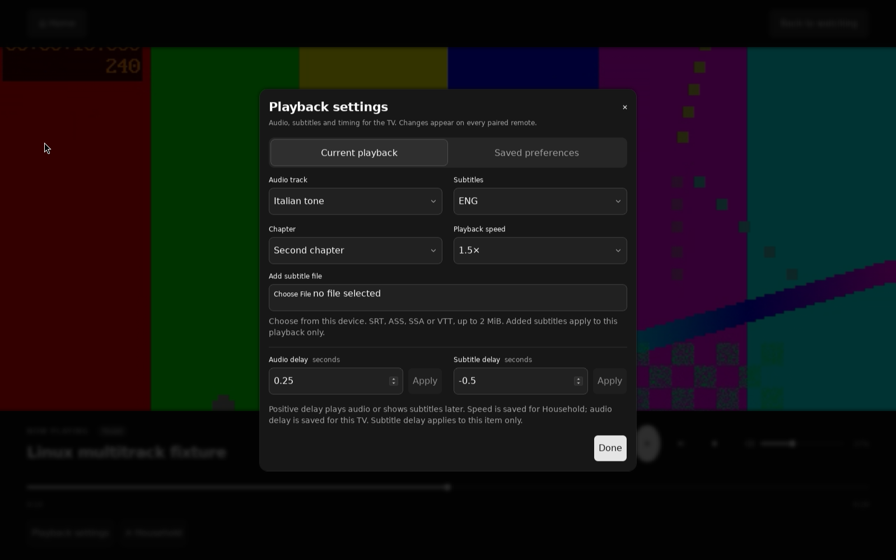

# Couch usage and development

A Linux TV player controlled by everyone on the local network. Tauri embeds
libmpv; Bun owns the shared queue, catalogs and paired browser remotes.



The screenshot shows shadcn playback settings over a generated test video in the
fullscreen Tauri app on Ubuntu 24.04 under Xvfb with basic rendering.

## Try it on this Mac

Start Docker, then run:

```sh
bun install --frozen-lockfile
bun run preview:linux
```

The command opens the real [web remote](http://127.0.0.1:4100), served by Bun
over HTTP. Its WebSocket connection keeps the queue, playback controls and saved
items current across devices. Open the separately printed
[Linux TV screen](http://127.0.0.1:6080/vnc.html?autoconnect=true&resize=scale)
to read the pairing code and see video playback.

The Linux TV screen uses noVNC only to display the Docker development desktop.
On a Linux mini PC, Tauri displays the app and embedded video directly. Phones
and laptops use the web remote in both setups. The Docker preview has silent
audio and software video rendering.

Select **Online** to browse YouTube, Twitch, RaiPlay or Bandcamp, then **Play**.
The launcher also prints a LAN URL for your phone. It keeps running after you
close the browser; `bun run preview:linux stop` stops it. Restart after source
changes to rebuild. See [preview options](../tests/preview/README.md) for mounting
your media folder and limiting access to this computer.

## Run

Install Bun 1.4.x, Rust stable and the [official Tauri Linux prerequisites](https://v2.tauri.app/start/prerequisites/#linux).
On Ubuntu 24.04 the build dependencies are:

```sh
sudo apt-get install libwebkit2gtk-4.1-dev build-essential curl wget file unzip libxdo-dev libssl-dev libayatana-appindicator3-dev librsvg2-dev libmpv-dev libgl1-mesa-dev ffmpeg
bun install --frozen-lockfile
bun run setup:media
bun run desktop
```

The project pins Bun 1.4.2 and Tauri 2.x packages in its lockfiles. Project
scripts use the pinned Bun runtime and do not need Node.js. The desktop command
builds the UI and compiled Bun sidecar before starting Tauri. Frontend changes
currently require restarting that command; Rust changes use Tauri's watcher.

Open a file, add a local or mounted NAS folder in Library, browse Radio, or
connect a Jellyfin server from the TV. Direct HTTP/HTTPS media URLs also work.
Press play in the shared queue. Open the LAN address shown in the app on another device
and enter its six-digit pairing code. Give the remote a name so Settings can
identify this browser. Every remote controls this one player.
The TV always fills its display. Home opens browsing over the mounted player;
Back closes the current menu, browsing view or playback controls. Phones and
laptops have a dedicated controller interface with no video surface.

In Radio, **Add avoid radio** imports the station index from
[`radio.avoid.quest/playlist.m3u`](https://radio.avoid.quest/playlist.m3u).
You can also save another Kodi-compatible radio M3U URL. Playlists retain their
station order, IDs, groups and logos. Refresh updates the shared catalog and
saved favorites; queued stations resolve their current URL when played.
A failed refresh keeps the last usable list. Every paired
remote can browse, refresh, queue or immediately play these stations.

The TV and remotes show a station's current track when the stream supplies ICY
or audio tags. The station name stays unchanged. Radio retries failed or ended
connections after 1, 2 and 4 seconds, then offers **Try again**. Stop, a newer
playback request and closing the TV cancel pending retries. Restart restores the
queue without reconnecting or playing automatically. Live rewind needs a buffer
and is not available.

**Online** provides YouTube search, channel sections and playlists; Twitch live
channels, categories and search; RaiPlay live TV, programs, episodes, search
and recent replays; and public Bandcamp albums and tracks. Save media, channels
and collections for every paired remote. Browsing remains local to each screen; queue changes and saved items
are shared. **Play** adds the selected item and starts it on the TV.

For other website links, select **Webpage** in the queue form. A blank title
requests the video's title and artwork automatically. Choose Best, 1080p, 720p
or 480p before adding a video; the queue remembers the choice. The app resolves
the link when playback starts and sends the original streams to libmpv, including
separate video/audio when supplied. It does not download a media file or encode
video. Public single items are supported through yt-dlp's extractors; account
login, arbitrary webpage playlist expansion and DRM remain unsupported.

`bun run setup:media` installs pinned official yt-dlp and Deno releases into the
desktop's private data directory after checking their SHA-256 hashes and
versions. It needs `unzip`, with no Python environment to configure. The desktop
finds these helpers automatically; `COUCH_YT_DLP` and `COUCH_DENO`
can override their paths. YouTube needs Deno/EJS:
yt-dlp currently rejects Bun versions newer than 1.3.14 for that helper role.
The application itself stays on Bun 1.4.2. See the
[official yt-dlp releases](https://github.com/yt-dlp/yt-dlp#release-files) and
[EJS requirements](https://github.com/yt-dlp/yt-dlp/wiki/EJS).

The default port is **4100**. Paired devices, the queue and chosen volume survive
restarts, as do library catalogs, radio playlists/favorites, online saved items
and the Jellyfin connection.
Playback does not start automatically after a restart. Press Play or Resume to
continue from the saved position, or choose Play from start to restart an item.
Local progress belongs to the selected watching profile, initially Household.
Use the profile button beside Playback settings to create or select a name;
stop playback before switching. Paired phones and laptops are controllers,
not watching profiles. Jellyfin progress belongs to its connected account.

For browser development without a native player:

```sh
bun run dev
```

Bun serves the UI with hot reload and prints the pairing code in the terminal.
Queue and pairing work; playback is explicitly unavailable. Run either this
server or the desktop app on port 4100. `COUCH_PORT` can select another
port, but keep it stable so remotes retain their address.

macOS can build and run the desktop UI/server, but this first native playback
implementation is Linux-only. To produce a local macOS debug app:

```sh
bun run desktop:build --debug --bundles app
```

## Administrator and connection settings

**Settings > This remote** saves the default online-video quality in this
browser. The TV's local browser calls this section **This screen**. Online and
Add media use that default for new videos; an override applies to one enqueue.
Existing queued videos keep their quality, and each remote keeps its own
default. This preference does not change the TV's display resolution.

An unclaimed TV opens **Settings > General** with its local address, an address-only
QR code, the six-digit controller pairing code and a separate ten-digit
administrator code. Pair your phone first, then open its **Settings > General**
and enter the administrator code. It expires after ten minutes and works once.
If it expires before use, select **Get new code** on the TV. Competing first
claims grant administration to one remote; existing paired devices remain ordinary
controllers.

The administrator phone can save the **TV name** in General. The committed name
appears on the TV and other remotes, and survives restart. General shows the name
read-only on the TV and ordinary remotes. Administrator status belongs to the
paired browser credential. It does not change the watching profile, local history
or connected Jellyfin account.

**Connection** shows the TV address, connection status, and this remote's name
and role. **Reconnect** keeps the browser paired and waits for a current snapshot
before enabling controls. **Pair again** forgets this browser's current credential
and returns to pairing. It does not revoke that credential on the server.
Existing pairings migrate with their exact token hashes preserved and receive
stable IDs and names such as Remote 1. They keep working after restart. Controller
listing, renaming, revocation and role management remain in the
[controller-management ticket](https://github.com/avoid-quest/couch/issues/11).

Folder and Jellyfin connection setup still require local TV input. Paired D-pad
commands cannot activate these controls, including actions in a dialog already
opened locally or a nested portal. Back and Home can dismiss the protected dialog.
Phone administration for [folders](https://github.com/avoid-quest/couch/issues/17)
and [Jellyfin](https://github.com/avoid-quest/couch/issues/18) is separate work.

### Recover administrator access

Recovery requires trusted local access to the TV computer. Stop Couch, generate
a fresh secret of 32 to 256 hexadecimal characters, and supply it through
`COUCH_ADMIN_RECOVERY_CODE` when restarting the app. For example, use
`openssl rand -hex 32` to generate a secret, then run these commands in a local
Bash terminal, entering the secret at the hidden prompt:

```bash
read -rsp 'Recovery secret: ' COUCH_ADMIN_RECOVERY_CODE
export COUCH_ADMIN_RECOVERY_CODE
bun run desktop
unset COUCH_ADMIN_RECOVERY_CODE
```

Pair the replacement browser, open **Settings > General**, and enter that secret
in **Administrator code**. Its ten-minute deadline starts when the server first
accepts the configured secret. Restarting with the same value neither extends
that deadline nor makes a consumed secret reusable. An expired or consumed secret
requires a fresh value and another local restart. Recovery grants administration
to the replacement browser; it does not revoke the old administrator.

Bun removes the recovery variable from its environment before starting media
helpers. The server stores a hash, and never sends the secret in a snapshot or
QR code. Recovery expiry, consumption and restart behavior are covered by the
server tests. The native/HTTP gate tests first-time phone claiming and persistence.

## Music and saved playlists

Add a music folder on the TV, then open Library's **Artists** or **Albums** tab
from any controller. Album artists keep compilations together. Tracks appear in
numeric disc/track order; **Play album on TV** appends the album and starts its
first track. **Add album to queue** leaves current playback running. Browsing
stays local to each screen.

Audio tags and embedded JPEG/PNG/WebP artwork use the maintained
`music-metadata` parser. Rescan existing folders to populate the new fields.
Metadata parsing is limited to files up to 512 MiB; covers are skipped above
64 MiB and limited to 2 MiB each. Larger or unreadable files remain playable
with a scan notice. Scans run at most two parser jobs and await them on shutdown;
a stalled mounted filesystem can delay shutdown because the parser has no
cancellation API. Video metadata still uses ffprobe.

Open **Saved playlists** beside Queue to save, rename, reorder or remove items,
update a saved list from the queue, or delete it. **Add to queue** appends;
**Replace queue** stops playback and loads the list; **Play playlist** replaces
the queue and starts the first item. Saved playlists belong to everyone paired
with this TV. They preserve duplicate songs as separate entries and reject edits
from an obsolete revision. Up to 100 playlists with 500 entries each persist
across restart, without autoplay. Host paths and resolved provider streams do
not appear in playlist HTTP responses.

Queue transitions currently stop and load the next source. The 2026-09-05
Bandcamp qualification capture measured 298.4 ms of silence between two lossless
tracks, with unmatched edge samples retained in the measurement's loss/repetition bounds. Gapless
playback, ReplayGain, cue sheets and crossfade remain open feature gates.

### Bandcamp albums and tracks

In **Online → Bandcamp**, open a public album or track link, or choose a suggested
album. Albums show artwork and their returned track order. **Add album to queue**
appends all tracks; **Play album** appends them and starts the first. Individual
tracks have Play, Queue and Save controls. Shared saved albums and tracks are
available from every paired device.

The host uses the existing yt-dlp worker, with a 30-second album deadline and a
500-track limit. It resolves each public track page afresh when played. An album
that exceeds the queue's remaining capacity leaves the queue unchanged. A newer
Stop or playback request cancels an earlier album's pending play request.

This supports public artist-subdomain `bandcamp.com/album/…` and `/track/…`
links. Account libraries, full-text search, artist discographies and custom
domains are not implemented. The displayed album contains the tracks returned
by yt-dlp; its extractor omits entries without duration, and later tracks can
still fail when playback checks their current availability.

## Resume, watched state and history

Library cards show saved positions and watched marks. The History tab lists
recently played local media and offers Resume, Play from start, watched controls
and Clear resume point. Each watching profile has its own records. Individually
opened files retain separate progress records from scanned library entries;
open the file on the TV again if it is no longer in the queue. Radio, live
streams and website playback do not create
local viewing history.

Bun checkpoints native observations every ten seconds and on observed pause or
seek, then flushes on stop, source changes, errors and shutdown. End of file marks
the item watched and clears its resume point. Stopping at or beyond 90% does the
same for items at least one minute long. Rewinding saves the lower position;
watched marks remain independent and can be changed manually. An abrupt power
loss can lose the interval since the last checkpoint. Normal restart restores
profiles, progress and queue without autoplay.

Jellyfin has All media and Continue watching views. Resume reads the latest
upstream position before loading and passes it to native playback. One host
reports progress, and an immediate replay waits for the preceding stop report.
The connected Jellyfin account is shown in its panel; local profile selection
does not change that account.

## TV and remote interface

Playback settings has Current playback and Saved preferences tabs. Choose
**Add subtitle file** on the TV or a paired phone to send an SRT, ASS, SSA or
WebVTT file from that device. Files are limited to 2 MiB, kept privately on the
host and removed after native playback acknowledges another source or Stop.
The subtitle selector shows libmpv's observed selection. Uploads apply to the
current playback only; reopening the item requires adding the file again.

Jellyfin text sidecars load through its authenticated subtitle API. Bun downloads
up to four at once, with an eight-second total deadline and a 2 MiB per-file
limit, before giving private files to libmpv. Stop cancels those downloads.
Unavailable subtitles leave the movie playable and show a subtitle error.
External image sidecars and subtitle search/download services remain unsupported.

The watching profile owns preferred audio/subtitle languages, default subtitle
mode and speed. Saved defaults apply on the next load. Changing current playback
speed also updates that profile's default. The TV device owns volume and audio
delay, shared by every profile. Subtitle delay and individual track choices apply
only to the current item. Every load resets them before applying profile defaults;
restarting restores preferences and the queue without autoplay.

The TV and HTTP remote use generated shadcn/ui Mira components, the neutral dark
theme and bundled Inter font from preset `b1D0dv72`. Phone controls have 44px
minimum touch targets; TV controls are larger. Arrow keys move between controls;
tabs, sliders and selects keep their keyboard behavior. Escape closes the topmost
menu or dialog and restores focus. The TV stays fullscreen throughout browsing,
playback and Stop, with one continuously mounted VideoStage.

On phones, Browse contains catalogs and a compact playback bar; Remote contains
transport, volume, settings and the TV directional pad. Desktop browsers show
the remote beside the catalog. Home, Back, Info, arrows and OK operate the TV
through authenticated, ephemeral commands. These commands are never replayed
after reconnect. Each browser retains its own catalog navigation.

The exact preset was applied with `bunx --bun shadcn@latest apply --preset b1D0dv72`
in a temporary supported Vite scaffold, because the CLI does not recognize this
Bun-only project. Generated configuration, theme and components were integrated
with the app's accessible slider labels and native portal layers. Couch uses Bun's
build pipeline and sole HTTP/WebSocket server. `bun-plugin-tailwind` runs for
development HTML, static Tauri assets and the compiled server's HTML; `bunfig.toml`
and both `Bun.build` calls configure it. No Vite server ships with the app.
See the [shadcn CLI](https://ui.shadcn.com/docs/cli) and
[Bun Tailwind integration](https://bun.com/docs/bundler/fullstack).

## Check and build

```sh
bun run check
bun run build
cargo test --manifest-path src-tauri/Cargo.toml --locked
bun run test:linux
bun run test:linux --jellyfin --live-radio
bun run test:linux --provider-catalogs
```

`bun run build` creates static UI assets in `dist/` and a native-target Bun
executable in `src-tauri/binaries/`. Build on the target OS and architecture;
cross-compiling the Rust media dependencies is not configured.

On Linux, `bun run desktop:build` uses Tauri's Debian/AppImage packaging. The
Debian configuration declares libmpv dependencies. Installer distribution,
AppImage media-library bundling and signed updates still need qualification.
The [Linux CI workflow](../.github/workflows/check.yml) checks TypeScript, Bun tests,
the sidecar build and Rust compilation/tests. It does not certify playback on
physical TV hardware.

`bun run test:linux` uses Docker and the official Tauri WebDriver. It builds the
actual Linux app, generates media fixtures and controls its native window plus
two paired remotes and an actual HTTP browser at phone width. Cargo and package caches use named volumes; the repository
is mounted read-only. Logs, screenshots and version details go to
`.artifacts/linux/`. The container is removed after the run.

The tests cover persistent queues and catalogs, native playback observations,
stale controls, track selection, subtitles, chapters, speed and timing offsets,
local resume/history and watching profiles, Jellyfin resume, keyboard/focus and
portal rendering, provider sessions, credential isolation and shutdown. Radio directory tests use
controlled HTTP responses; public station searches were also checked manually.

The 2026-09-05 administrator/Settings integration run passed 450 native/HTTP
checks with Jellyfin and live radio. Linux also passed 295 Bun tests with two
skipped and 2,295 assertions, twelve app Rust/ABI tests and five libmpv
DASH/resume/subtitle/radio regressions. Local checks passed 291 Bun tests with six
skipped and 2,260 assertions; the local build and eight macOS Rust tests passed.
The separate provider gate passed all eleven cases and restart persistence with
the same production binaries.

The HTTP phone checks use a 390px viewport; native screenshots verify video and
dialog/select composition. The first administrator claim, TV-name save and
restart ran through the real app with disposable data. API and store tests cover
claim races, expiry, recovery, unchanged legacy pairing hashes and authorization
rechecks before mutation. Native tests verify that paired D-pad input cannot
activate pre-opened local folder or Jellyfin controls. A separate DOM regression
covers the nested-portal case with an unguarded positive control.

General and Connection were visually inspected in the in-app browser at 320,
375, 390, 768, 1024, 1440 and 1920px widths; the native setup dialog and QR were
also inspected. The development preview keeps the original five queue entries
and pairings and remains unclaimed so the owner can claim their own phone.

The earlier catalog and Bandcamp increment was checked at the same seven widths, with no video surface, horizontal
page overflow or clipped action labels across all five catalogs. The Bandcamp
22-track album also passed those seven viewport checks with decoded artwork.

Bandcamp native playback passed for Mastodon's Hail to Fire, Blazo's Intro and
the album's next track, Kero One - Keep It Alive (Blazo remix). The TV and phone
queued the 22 returned album tracks in order. Source replacement, Stop and
reconnect worked, and 74 queue entries plus eight saved items survived a desktop
restart without autoplay. A deliberately missing track showed a provider error
and left the queue unchanged. This does not qualify every track in the album;
[provider evidence](research/providers.md#public-provider-checks) records the
tested links, artwork checks and upstream limits.

External-subtitle checks use real TV SRT and phone ASS uploads plus an
authenticated Jellyfin SRT sidecar. Native pixel comparisons verify visible
glyphs on an unchanged paused frame. The suite also checks upload failures,
private file permissions, source cleanup and observed preference selection after
a desktop restart.

Music checks cover tagged MP3/FLAC/M4A and persisted artwork in the compiled
sidecar, artist/album navigation and all saved-playlist operations on the TV and
phone. The native audio capture and its conservative sample-matching analysis
are retained beside the playback screenshots.

The Linux test uses `COUCH_BASIC_RENDERING=1` because default rendering
also produces corrupted frames in standalone mpv inside this Docker environment.
The option selects mpv's basic GPU rendering path and disables advanced scalers
and custom shaders. It leaves the decoder and GL driver unchanged. The app's
normal default remains the advanced renderer.

A clocked PulseAudio null sink lets audio-only streams advance without physical
speakers. Advanced rendering, HDMI sound, hardware decode, Wayland, HDR, refresh
switching and suspend/resume still need checks on the TV hardware.

The debug container measured the Bun coordinator at about 59 MiB RSS. WebKit
and native rendering used considerably more memory with software rendering;
this is a starting measurement, not a release or TV-hardware benchmark.
Each Linux run saves process memory and binary sizes beside its screenshots.

## How the pieces fit

- `src/client`: React UI and a small WebSocket connection hook, shared by TV and remotes.
- `src/server`: Bun HTTP/WebSocket routes, authoritative session and SQLite storage.
- `src/shared/protocol.ts`: typed application messages and the private playback contract.
- `src/main.ts`: Bun entry point, HTML import and native pipe lifecycle.
- `src-tauri/src`: window, file picker, sidecar owner and native playback worker.

Bun supplies [HTML bundling/HMR](https://bun.com/docs/bundler/fullstack),
[WebSocket pub/sub](https://bun.com/docs/runtime/http/websockets),
[SQLite](https://bun.com/docs/runtime/sqlite) and
[compiled executables](https://bun.com/docs/bundler/executables). Tauri supplies
the window and official sidecar, single-instance, dialog and logging plugins.
Rust sends observed playback state to Bun through a private pipe. Bun broadcasts
complete current-state snapshots. Disconnected clients do not queue old actions
for replay.

The app reuses a released native video plugin. Vendored patches expose its
Rust driver, supply missing observations, correct libmpv binding layouts and
lifetimes, and fix a GTK parent assumption in the released Tauri runtime.
Exact versions, archive hashes and changes are documented
in [native dependency patches](../src-tauri/vendor/README.md). Those patches should
disappear as compatible upstream releases become available.

Desktop data uses Tauri's application data directory. Standalone development uses
`.data/`; `COUCH_DATA_DIR` overrides it. Remote requests need a paired token;
only the trusted TV app may configure folders or Jellyfin credentials. Remotes
queue library IDs; the host checks file containment again when playback starts.
Arbitrary web content has no
Tauri command access.

## Remaining product work

The app has audio/subtitle selection, subtitle off, chapters, speed and timing
offsets. Library scanning uses music-metadata for audio, ffprobe for video and SQLite FTS5 for search;
missing mounts retain their catalog. Radio supports saved M3U station feeds,
Radio Browser search with mirror failover, and shared favorites. Jellyfin uses its official SDK for browsing,
direct-play negotiation and one host progress reporter. Credentials and resolved
stream headers stay on the host.

Full Kodi parity still needs work: profile editing/removal, video artwork and
metadata enrichment, cue sheets, ReplayGain, gapless audio, TV guides/DVR,
CEC and hardware output qualification. Jellyfin remuxing/transcoding and DRM
playback are not enabled. Speaker multiroom is later.

Implementation pauses after the administrator/Settings increment. The
[appliance map](https://github.com/avoid-quest/couch/issues/1) owns installation,
Settings, controller management, output selection and updates. The linked
[media map](https://github.com/avoid-quest/couch/issues/25) owns the remaining
playback and library tickets. Publishing those tickets does not start them.

The [feature matrix](research/feature-parity.md),
[architecture](research/architecture.md), [playback research](research/playback.md)
and [provider research](research/providers.md) retain capability evidence and limits.
